<!--
_class: centered
-->

# Getting data in the database and backups

---

# plan

- demo on dumping a database (pgadmin, CLI)
- demo on restoring a database (pgadmin, CLI)


Then you will import the titanic dataset

- download the csv data file on your local
- create the database and the table
- import the data
- restore the database in that file either using pgadmin or CLI


---
# in short

You cna use pgadmin or CLI to backup and restore your data

- you can either backup your data as a compressed **dump file**
- or you can dump the data as a **SQL file**

### dump file

- you use pg_dump, pg_restore

```bash
pg_dump -U alexis -h localhost -p 5432 -f <path>/treesdb_backup.pg_dump postgres

pg_restore -U alexis -h localhost -p 5432 -d treesdb_backup <path>/treesdb_backup.pg_dump
```

### SQL file

You execute the sql file with psql on a given database


---
# Demo : data backup

On my local, I have many databases

**pgAdmin**

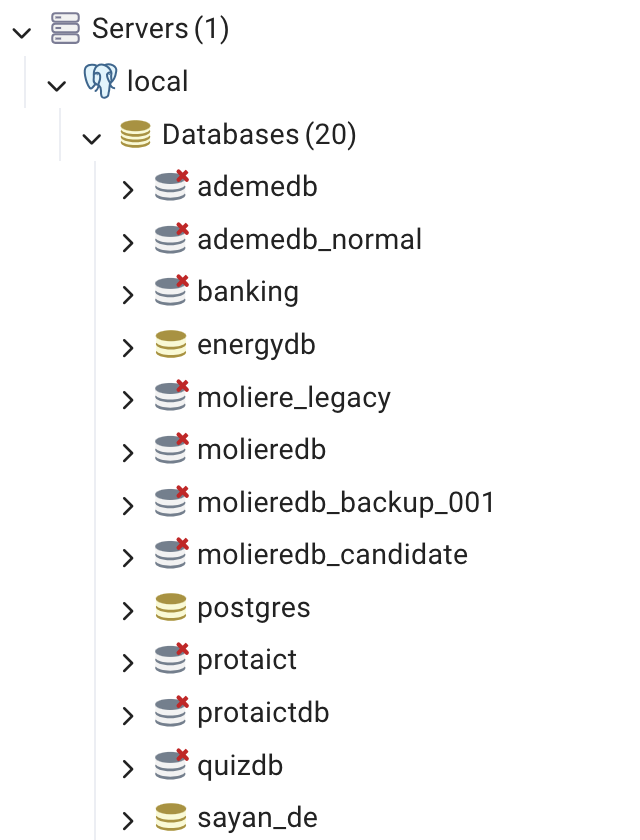


**CLI** : `\l`

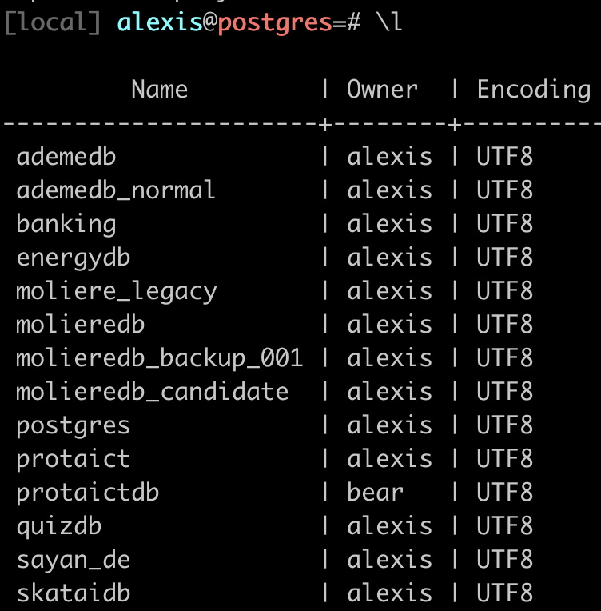


---

Let's back up one of these, for instance the treesdb_v01 database

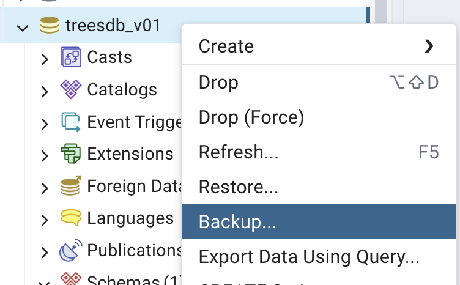

- Let's name the backup file `treesdb_backup.pg_dump`
- Add a compression ratio from 1 to 9 (max) if you want to also compress your database. Then you should add `.gz` to the filename `treesdb_backup.pg_dump.gz` to indicate it is a commpressed file.
- select `UTF-8` for encoding.
- for format : select plain (missing from the screenshot)

---

in the **data options** tab, select
- `pre data`: includes the creation of the database and the user
- `data`: includes the data
- `blobs`: includes all the data


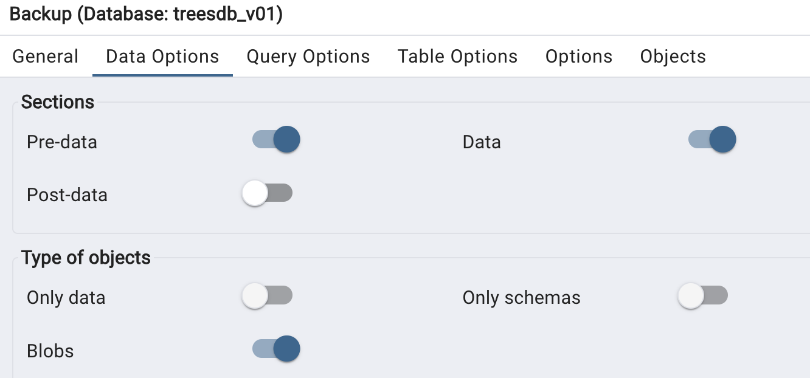

---

in the "Query Options section", select

- include Create database
- include DROP database
- include IF EXISTS


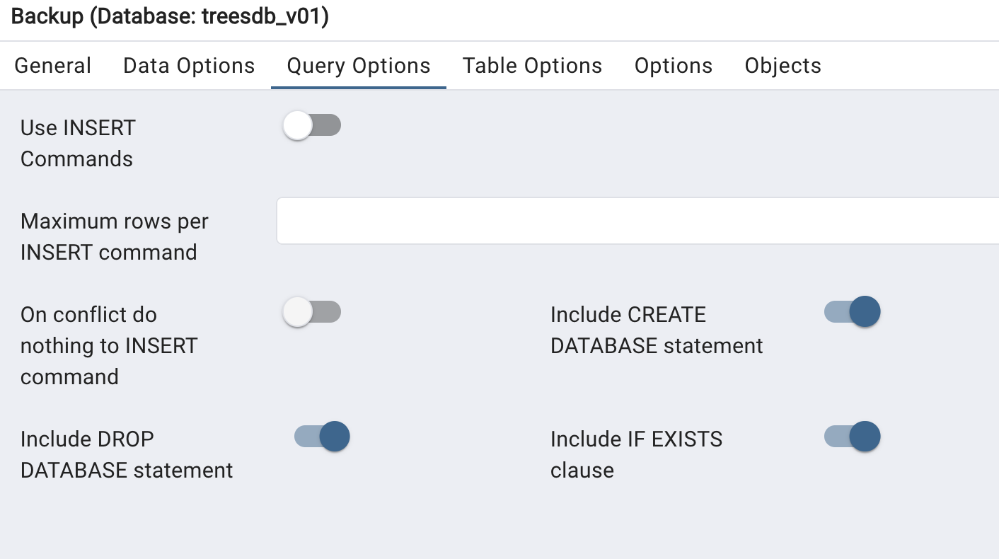


Nothing to do for the other tabs

and click `Backup`


---

# Process


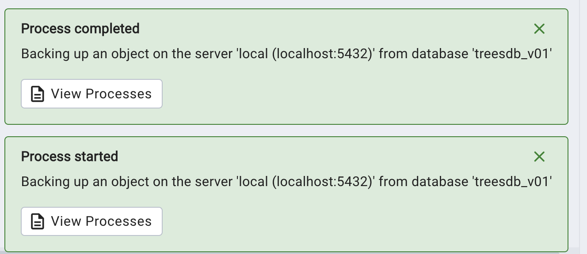


if we click on the process we see the CLI equivalent

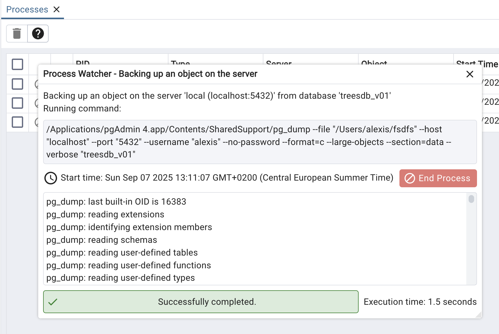


```bash
/<path>/pg_dump
--file "/Users/alexis/treesdb_backup.pg_dump"
--host "localhost" --port "5432" --username "alexis" --no-password
--format=p
--large-objects
--encoding "UTF8"
--section=pre-data
--section=data
--create
--clean
--if-exists
--verbose "treesdb_v01"
```

We can find all the settings that we selected in pgAdmin

I can copy paste that command into my terminal and it will / should work

---

# Now let's ... restore

[Download the dataset](https://drive.google.com/file/d/1VSaeGFKFI-RMCUhh7vVr1jXPZJMhrFNd/view?usp=sharing)


And restore it

Since the dump file is in plain text, it is just SQL statements that we can execute with `psql`.

```sh
psql -U alexis -h localhost -p 5432 -f <path>/treesdb_backup.pg_dump postgres
```

The `-f` simply says execute the file `treesdb_backup.pg_dump`.

# Note

If I had used `format=c` (compressed) then to restore it I would have used `pg_restore`

```sh
pg_restore -U alexis -h localhost -p 5432 -d treesdb_backup <path>/treesdb_backup.pg_dump
```

---

# ✅ run a sql file In pgAdmin

First **rename** your file from `treesdb_backup.pg_dump` to `treesdb_backup.pg_dump.sql`

pgAdmin won't open the file when it does not have the .sql extension


Then to run a dump file or any SQL file:

- Select a database (`postgres` is fine)
- Open the **Query Tool** on your server/DB.
- Go to the File icon / Open and select your `treesdb_backup.pg_dump.sql` file.
- The contents load into the Query Editor.
- Press the Execute (▶) button to run it.

This will execute the SQL statements in your dump (including CREATE DATABASE if you included it).

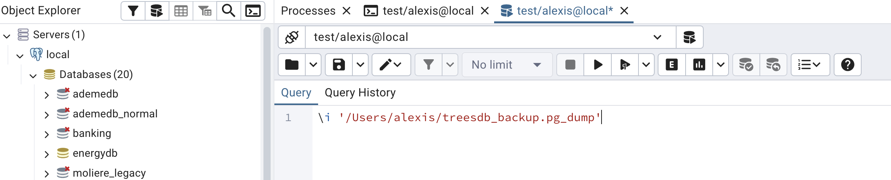

At this point you can simply use the PSQL tool in pgAdmin
and run the above command

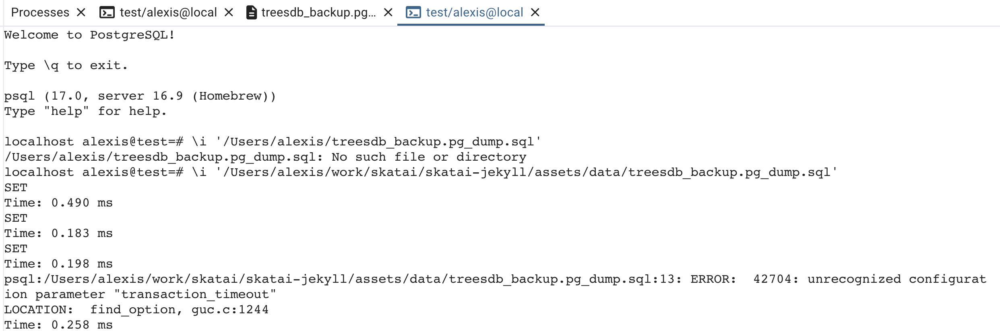

---
<!--
_class: centered
-->

# from now on, I will only use PSQL

---

The titanic dataset is a classic dataset used in machine learning competitions


A list of the 891 passengers with their survival status, age, sex, class, fare, etc.

The kaggle competition is to predict the survival of the passengers based on their features.

Here we will just load the dataset into a database and review some basic SQL queries.

The goal of the exercise is to be able to import any csv dataset into a database.

---


Titanic CSV fields are:

- PassengerId – integer, unique
- Survived – integer (0 = No, 1 = Yes)
- Pclass – passenger class (1, 2, 3)
- Name – passenger name
- Sex – male/female
- Age – float (because of decimals, and some NULLs)
- SibSp – number of siblings/spouses aboard
- Parch – number of parents/children aboard
- Ticket – ticket number
- Fare – float
- Cabin – cabin string, often NULL
- Embarked – port of embarkation (C, Q, S)


---

# Steps

In order to import a csv file into a database

we will

- create the database
- create a simple table
- import the csv file into the table

---

# Server vs Database vs Tables

- Postgresql runs on a server
- you connect to a database
- a database is a collection of tables


---

# database creation

```sql
CREATE DATABASE titanicdb;
```

in pgAdmin, right click on `Databases (n)` and select `Create Database`
- add a name
- check out the SQL tab.

It will show the SQL command that will be executed
```sql
CREATE DATABASE titanicdb
    WITH
    OWNER = alexis
    ENCODING = 'UTF8'
    LOCALE_PROVIDER = 'libc'
    CONNECTION LIMIT = -1
    IS_TEMPLATE = False;
```

Note: it's always good practice to name the database with a `db` postfix or prefix.


> once the titanicdb has been created connect to it with

```sql
\c titanicdb
```

---
# CLI

you can use the `createdb` command to create a database from the command line

```sh
createdb titanicdb
```

---

# Create the table


```sql
CREATE TABLE titanic (
    passenger_id SERIAL PRIMARY KEY,
    survived     BOOLEAN,
    pclass       SMALLINT ,
    name         TEXT NOT NULL,
    sex          VARCHAR(10),
    age          REAL,
    sibsp        SMALLINT,
    parch        SMALLINT,
    ticket       TEXT,
    fare         NUMERIC(8,2),
    cabin        TEXT,
    embarked     CHAR(1)
);
```

where
- SERIAL is an auto-incrementing integer
- BOOLEAN is a boolean
- SMALLINT is a small integer
- TEXT is a text
- VARCHAR is a variable length string
- REAL is a real number
- NUMERIC is a numeric number
- CHAR is a character string


This is very precise. we could have used text for all strings and int / real for numbers

Note: there are no constraints on the table.


---

# check

`\d` lists all the assets (tables, views, functions, etc.) in the current database

we have

```sh
localhost alexis@titanicdb=# \d
                   List of relations
 Schema |           Name           |   Type   | Owner
--------+--------------------------+----------+--------
 public | titanic                  | table    | alexis
 public | titanic_passenger_id_seq | sequence | alexis
```

---
# sequence ?

Let's check out the sequence

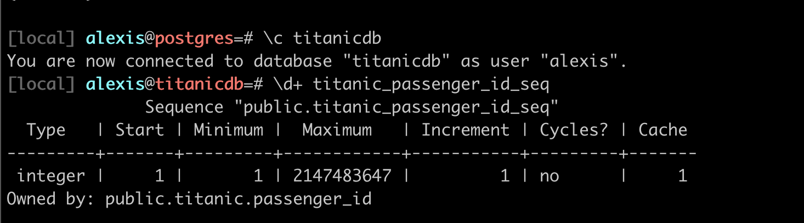

shows the behavior of the passenger_id serial number: from 1, increment 1, etc

---

# Table

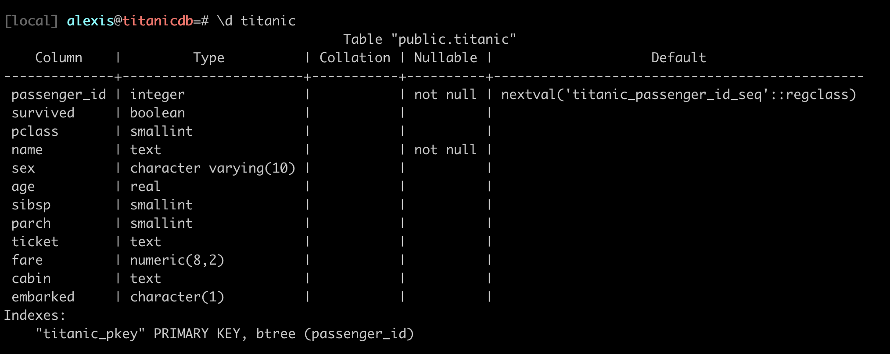


Notice in the last column.

```sql
 nextval('titanic_passenger_id_seq'::regclass)
```

We can actually select the next value of the sequence

```sql
SELECT nextval('titanic_passenger_id_seq'::regclass);
```

Since our table is empty, this will return 1, then 2 etc


---

# Import the csv data

Now to import the csv file into the table

```sql
COPY titanic FROM '/path/to/titanic.csv' DELIMITER ',' CSV HEADER;
```

or

```sql
\copy titanic FROM '/path/to/titanic.csv' DELIMITER ',' CSV HEADER;
```

There may be permission issues with the 1st `COPY` clause.


> Note: you must use the absolute path to the file

if everything goes well you should have


```sh
COPY 891
```

and to verify this query should also return 891

```sql
SELECT COUNT(*) FROM titanic;
```

---

# The CSV Import Challenge

**Common Problems You'll Face:**:

- 🔤 Character encoding (é, à, ñ, 中文)
- ❌ Missing values (empty cells, NULL, N/A)
- 📊 Wrong separators (`;` instead of `,`)
- 🔢 Type mismatches ("123" as text vs 123 as number)
- 📅 Date formats (DD/MM/YYYY vs MM/DD/YYYY)


---

# Practice dumping and restoring the data

In pgAdmin or in the terminal

First backup the titanicdb database, without compression
- play with the options in pgAdmin: pre-data, data, post-data
- you will get a SQL file
- open the sql file in an editor and check the content.
- identify which part is the data and which part is the schema
- identify which part is the pre-data and which part is the post-data


Then

- create a new database titanicdb_restored
- restore the titanicdb database from the backup SQL file

Now dump the titanicdb database, this time with compression

You will get a pg_dump file

- dump the titanicdb database with compression
- restore the titanicdb_compressed database from the dump file

---

To finish, let's practice some basic queries.

[practice-queries-titanic](/dbsql/practice-queries-titanic/)
