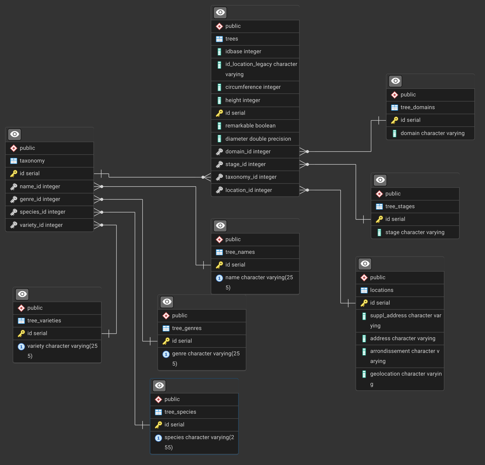

# Let's practice Windows functions

---

# dataset

We'll work on the normalized version of the trees db

- download the sql backup from [https://skatai.com/assets/db/treesdb_v03_normalized.sql](https://skatai.com/assets/db/treesdb_v03_normalized.sql)

- restore the database

**from the terminal**

```bash
psql -d postgres -f <path to the sql backup>/treesdb_v03_normalized.sql
```

**or within a PSQL session**

```sql
\i <path to the sql backup>/treesdb_v03_normalized.sql
```

This will create a new database called `treesdb_v03_normalized`

## explore

Check out the tables, make a few queries to get a sense of the data.


The ERD is




---

# Window Functions Exercises - Paris Trees Database

## Level 1: Basic Data Exploration with Window Functions

### Exercise 1.1: Understanding the Overall Dataset

**Why**: Before diving into analysis, we need to know: How many trees do we have? How many are missing critical measurements? What's the data quality like?

**Goal**: Show overall counts and percentages of NULL values for key measurements.

**Hint**: Use COUNT(*) OVER() for total trees, and COUNT(column) OVER() for non-null counts. Calculate percentages by dividing counts.

**Query Structure**:
```sql
SELECT
    -- Show a sample of tree IDs
    -- Calculate total trees using window function
    -- Count non-null heights
    -- Count non-null circumferences
    -- Calculate percentage of trees with height data
FROM trees
LIMIT 10;
```

<details>
<summary><strong>Solution</strong></summary>

```sql
SELECT
    id,
    COUNT(*) OVER() AS total_trees,
    COUNT(height) OVER() AS trees_with_height,
    COUNT(circumference) OVER() AS trees_with_circumference,
    ROUND(COUNT(height) OVER()::numeric / COUNT(*) OVER() * 100, 2) AS pct_with_height,
    ROUND(COUNT(circumference) OVER()::numeric / COUNT(*) OVER() * 100, 2) AS pct_with_circumference
FROM trees
LIMIT 10;
```

**Key Insight**: All rows show the same totals because window functions without PARTITION BY operate on the entire dataset.
</details>

---

### Exercise 1.2: Data Quality by Arrondissement

**Why**: Paris has 20 arrondissements. We need to understand if data quality varies by location - are some districts better at recording tree measurements?

**Goal**: For each arrondissement, count total trees and trees with valid measurements (height > 0).

**Hint**:
- Join with locations table to get arrondissement
- Use PARTITION BY arrondissement
- Filter WHERE height > 0 to exclude zeros and nulls
- Use COUNT(*) vs COUNT(CASE WHEN...) to compare totals

**Query Structure**:
```sql
SELECT DISTINCT
    l.arrondissement,
    COUNT(*) OVER(PARTITION BY ...) AS total_trees,
    -- Count trees where height > 0 within each arrondissement
    -- Calculate percentage
FROM trees t
JOIN locations l ON ...
WHERE l.arrondissement IS NOT NULL
ORDER BY ...;
```

<details>
<summary><strong>Solution</strong></summary>

```sql
SELECT DISTINCT
    l.arrondissement,
    COUNT(*) OVER(PARTITION BY l.arrondissement) AS total_trees,
    COUNT(CASE WHEN t.height > 0 THEN 1 END) OVER(PARTITION BY l.arrondissement) AS trees_with_valid_height,
    ROUND(
        COUNT(CASE WHEN t.height > 0 THEN 1 END) OVER(PARTITION BY l.arrondissement)::numeric /
        COUNT(*) OVER(PARTITION BY l.arrondissement) * 100,
        2
    ) AS pct_valid_height
FROM trees t
JOIN locations l ON t.location_id = l.id
WHERE l.arrondissement IS NOT NULL
ORDER BY l.arrondissement;
```

**Key Insight**: Using DISTINCT gives us one row per arrondissement. We see which districts have better data quality.
</details>


```sql
SELECT
    l.arrondissement,
    COUNT(*) AS total_trees,
    COUNT(CASE WHEN t.height > 0 THEN 1 END) AS trees_with_valid_height,
    ROUND(
        COUNT(CASE WHEN t.height > 0 THEN 1 END)::numeric /
        COUNT(*) * 100,
        2
    ) AS pct_valid_height
FROM trees t
JOIN locations l ON t.location_id = l.id
WHERE l.arrondissement IS NOT NULL
GROUP BY l.arrondissement
ORDER BY l.arrondissement;

```

---

### Exercise 1.3: Stage Distribution Analysis

**Why**: The stage field has inconsistent values. We need to see what stages exist and how many trees are in each stage vs how many have NULL stage.

**Goal**: Show the distribution of trees across different development stages, including NULL values.

**Hint**:
- Use COALESCE to handle NULL stages
- PARTITION BY stage to get counts per stage
- Order by count to see most common stages first

**Query Structure**:
```sql
SELECT DISTINCT
    COALESCE(ts.stage, 'Unknown/NULL') AS stage,
    COUNT(*) OVER(PARTITION BY ...) AS trees_in_stage,
    ROUND(COUNT(*) OVER(PARTITION BY ...)::numeric / COUNT(*) OVER() * 100, 2) AS pct_of_total
FROM trees t
LEFT JOIN tree_stages ts ON ...
ORDER BY trees_in_stage DESC;
```

<details>
<summary><strong>Solution</strong></summary>

```sql
SELECT DISTINCT
    COALESCE(ts.stage, 'Unknown/NULL') AS stage,
    COUNT(*) OVER(PARTITION BY t.stage_id) AS trees_in_stage,
    ROUND(COUNT(*) OVER(PARTITION BY t.stage_id)::numeric / COUNT(*) OVER() * 100, 2) AS pct_of_total
FROM trees t
LEFT JOIN tree_stages ts ON t.stage_id = ts.id
ORDER BY trees_in_stage DESC;
```

**Key Insight**: You'll likely see that many trees have NULL stage, and the stage names are inconsistent ('Jeune Arbre(Adulte)' mixed with 'Adulte').
</details>

---

## Level 2: Understanding Distributions and Outliers

### Exercise 2.1: Height Distribution Statistics

**Why**: We have outliers and zeros in the height data. Let's see the distribution: What are typical heights? Where are the outliers?

**Goal**: Calculate percentiles and quartiles for tree heights to understand the distribution, excluding zeros.

**Hint**:
- Filter WHERE height > 0
- Use NTILE(4) for quartiles
- Use PERCENT_RANK() to see percentile positions
- Show min/max heights within each quartile

**Query Structure**:
```sql
SELECT
    id,
    height,
    -- percentile rank
    -- quartile
    -- min/max within quartile
FROM trees
WHERE height > 0
ORDER BY height
-- Sample different parts of the distribution
LIMIT 100;
```

<details>
<summary><strong>Solution</strong></summary>

```sql
SELECT
    id,
    height,
    height_quartile,
    percentile,
    MIN(height) OVER(PARTITION BY height_quartile) AS quartile_min,
    MAX(height) OVER(PARTITION BY height_quartile) AS quartile_max,
    ROUND(AVG(height) OVER(PARTITION BY height_quartile)::numeric, 2) AS quartile_avg
FROM (
    SELECT
        id,
        height,
        NTILE(4) OVER(ORDER BY height) AS height_quartile,
        ROUND(PERCENT_RANK() OVER(ORDER BY height)::numeric * 100, 2) AS percentile
    FROM trees
    WHERE height > 0
) subquery
ORDER BY height DESC
LIMIT 100;
```

**Key Insight**: By ordering DESC and limiting, you can see the outliers. Try changing to ORDER BY height ASC to see the smallest values.
</details>

---

### Exercise 2.2: Identifying Extreme Outliers

**Why**: Some measurements might be data entry errors. Let's find trees that are unusually tall or short compared to their domain (public parks vs streets have different typical sizes).

**Goal**: Compare each tree's height to the average in its domain and flag extreme outliers.

**Hint**:
- Calculate domain average and standard deviation using window functions
- Calculate z-score: (height - average) / stddev
- Trees with |z-score| > 3 are extreme outliers

**Query Structure**:
```sql
SELECT
    t.id,
    td.domain,
    t.height,
    ROUND(AVG(t.height) OVER(PARTITION BY ...)::numeric, 2) AS domain_avg_height,
    ROUND(STDDEV(t.height) OVER(PARTITION BY ...)::numeric, 2) AS domain_stddev,
    -- Calculate z-score
    CASE WHEN ... THEN 'Outlier' ELSE 'Normal' END AS outlier_flag
FROM trees t
LEFT JOIN tree_domains td ON t.domain_id = td.id
WHERE t.height > 0
ORDER BY ABS((height - AVG...) / STDDEV...) DESC
LIMIT 50;
```

<details>
<summary><strong>Solution</strong></summary>

```sql
SELECT
    t.id,
    td.domain,
    t.height,
    ROUND(AVG(t.height) OVER(PARTITION BY t.domain_id)::numeric, 2) AS domain_avg_height,
    ROUND(STDDEV(t.height) OVER(PARTITION BY t.domain_id)::numeric, 2) AS domain_stddev,
    ROUND(
        (t.height - AVG(t.height) OVER(PARTITION BY t.domain_id)) /
        NULLIF(STDDEV(t.height) OVER(PARTITION BY t.domain_id), 0)
    ::numeric, 2) AS z_score,
    CASE
        WHEN ABS((t.height - AVG(t.height) OVER(PARTITION BY t.domain_id)) /
                 NULLIF(STDDEV(t.height) OVER(PARTITION BY t.domain_id), 0)) > 3
        THEN 'Extreme Outlier'
        WHEN ABS((t.height - AVG(t.height) OVER(PARTITION BY t.domain_id)) /
                 NULLIF(STDDEV(t.height) OVER(PARTITION BY t.domain_id), 0)) > 2
        THEN 'Moderate Outlier'
        ELSE 'Normal'
    END AS outlier_flag
FROM trees t
LEFT JOIN tree_domains td ON t.domain_id = td.id
WHERE t.height > 0 AND td.domain IS NOT NULL
ORDER BY ABS((t.height - AVG(t.height) OVER(PARTITION BY t.domain_id)) /
             NULLIF(STDDEV(t.height) OVER(PARTITION BY t.domain_id), 0)) DESC
LIMIT 50;
```

**Key Insight**: NULLIF prevents division by zero. You'll see which trees have suspicious measurements.
</details>

---

## Level 3: Ranking and Comparison

### Exercise 3.1: Top Trees per Arrondissement

**Why**: Each arrondissement might want to showcase its most impressive trees. Let's find the top 5 tallest trees in each district.

**Goal**: Rank trees by height within each arrondissement and filter to top 5.

**Hint**:
- Use RANK() OVER(PARTITION BY arrondissement ORDER BY height DESC)
- You'll need to wrap in a subquery or use the rank directly
- Include tree name for context

**Query Structure**:
```sql
SELECT
    l.arrondissement,
    tn.name AS tree_name,
    t.height,
    RANK() OVER(...) AS height_rank_in_arr
FROM trees t
JOIN locations l ON ...
JOIN taxonomy tax ON ...
LEFT JOIN tree_names tn ON ...
WHERE t.height > 0 AND l.arrondissement IS NOT NULL
ORDER BY l.arrondissement, height_rank_in_arr
-- Note: This will show many rows. How would you filter to top 5 per arrondissement?
LIMIT 100;
```

<details>
<summary><strong>Solution</strong></summary>

```sql
SELECT
    l.arrondissement,
    tn.name AS tree_name,
    tg.genre,
    t.height,
    t.circumference,
    RANK() OVER(PARTITION BY l.arrondissement ORDER BY t.height DESC) AS height_rank
FROM trees t
JOIN locations l ON t.location_id = l.id
JOIN taxonomy tax ON t.taxonomy_id = tax.id
LEFT JOIN tree_names tn ON tax.name_id = tn.id
LEFT JOIN tree_genres tg ON tax.genre_id = tg.id
WHERE t.height > 0
  AND l.arrondissement IS NOT NULL
  AND RANK() OVER(PARTITION BY l.arrondissement ORDER BY t.height DESC) <= 5
ORDER BY l.arrondissement, height_rank;
```

**Note**: In PostgreSQL, you can use window functions directly in WHERE clause with some limitations. More commonly, you'd use a subquery:

```sql
SELECT * FROM (
    SELECT
        l.arrondissement,
        tn.name AS tree_name,
        t.height,
        RANK() OVER(PARTITION BY l.arrondissement ORDER BY t.height DESC) AS height_rank
    FROM trees t
    JOIN locations l ON t.location_id = l.id
    JOIN taxonomy tax ON t.taxonomy_id = tax.id
    LEFT JOIN tree_names tn ON tax.name_id = tn.id
    WHERE t.height > 0 AND l.arrondissement IS NOT NULL
) ranked
WHERE height_rank <= 5
ORDER BY arrondissement, height_rank;
```

**Key Insight**: This gives you exactly 5 trees per arrondissement (or fewer if ties exist with RANK).
</details>

---

### Exercise 3.2: Comparing ROW_NUMBER vs RANK

**Why**: Understanding when to use ROW_NUMBER vs RANK is crucial. Let's see them side-by-side with trees that have identical heights.

**Goal**: Find trees with height = 20 meters (a common height) and compare how ROW_NUMBER and RANK behave.

**Hint**:
- Filter WHERE height = 20
- Show both ROW_NUMBER() and RANK()
- Order by height then by id to make row_number deterministic

**Query Structure**:
```sql
SELECT
    t.id,
    tn.name,
    t.height,
    ROW_NUMBER() OVER(ORDER BY ...) AS row_num,
    RANK() OVER(ORDER BY ...) AS rank_num,
    DENSE_RANK() OVER(ORDER BY ...) AS dense_rank_num
FROM trees t
JOIN taxonomy tax ON ...
LEFT JOIN tree_names tn ON ...
WHERE t.height = 20
LIMIT 30;
```

<details>
<summary><strong>Solution</strong></summary>

```sql
SELECT
    t.id,
    tn.name,
    t.height,
    t.circumference,
    ROW_NUMBER() OVER(ORDER BY t.height DESC, t.circumference DESC, t.id) AS row_num,
    RANK() OVER(ORDER BY t.height DESC, t.circumference DESC) AS rank_num,
    DENSE_RANK() OVER(ORDER BY t.height DESC, t.circumference DESC) AS dense_rank_num
FROM trees t
JOIN taxonomy tax ON t.taxonomy_id = tax.id
LEFT JOIN tree_names tn ON tax.name_id = tn.id
WHERE t.height = 20
ORDER BY t.circumference DESC, t.id
LIMIT 50;
```

**Key Insight**:
- ROW_NUMBER: Always unique (1,2,3,4,5...)
- RANK: Gaps after ties (1,2,2,4,5...)
- DENSE_RANK: No gaps (1,2,2,3,4...)

Since all have height=20, we order by circumference as a tiebreaker to see the differences.
</details>

---

### Exercise 3.3: Species Popularity Ranking

**Why**: Which tree species are most common in Paris? Let's rank species by count across the entire city.

**Goal**: Count trees per species and rank species by popularity.

**Hint**:
- GROUP BY or use DISTINCT with COUNT(*) OVER(PARTITION BY species)
- RANK() the species by their counts
- Filter out NULL species

**Query Structure**:
```sql
SELECT DISTINCT
    ts.species,
    COUNT(*) OVER(PARTITION BY ...) AS tree_count,
    RANK() OVER(ORDER BY COUNT(*) OVER(...) DESC) AS popularity_rank
FROM trees t
JOIN taxonomy tax ON ...
JOIN tree_species ts ON ...
WHERE ts.species IS NOT NULL
ORDER BY popularity_rank
LIMIT 20;
```

<details>
<summary><strong>Solution</strong></summary>

```sql
SELECT DISTINCT
    ts.species,
    tg.genre,
    COUNT(*) OVER(PARTITION BY tax.species_id) AS tree_count,
    RANK() OVER(ORDER BY COUNT(*) OVER(PARTITION BY tax.species_id) DESC) AS popularity_rank,
    ROUND(COUNT(*) OVER(PARTITION BY tax.species_id)::numeric / COUNT(*) OVER() * 100, 2) AS pct_of_total
FROM trees t
JOIN taxonomy tax ON t.taxonomy_id = tax.id
JOIN tree_species ts ON tax.species_id = ts.id
LEFT JOIN tree_genres tg ON tax.genre_id = tg.id
WHERE ts.species IS NOT NULL
ORDER BY popularity_rank
LIMIT 30;
```

**Key Insight**: You'll see which species dominate Paris's urban forest. The top species likely make up a large percentage of all trees.
</details>

---

## Level 4: Time-Series Like Analysis with LAG/LEAD

### Exercise 4.1: Height Progression Analysis

**Why**: When trees are ordered by height, what are the gaps between sizes? Are there natural groupings or sudden jumps?

**Goal**: Order trees by height and show the difference from the previous tree's height.

**Hint**:
- Use LAG(height) to get previous height
- Calculate difference: height - LAG(height)
- Filter to heights > 5 to see meaningful differences

**Query Structure**:
```sql
SELECT
    id,
    height,
    LAG(height) OVER(ORDER BY height) AS previous_height,
    height - LAG(...) AS height_jump
FROM trees
WHERE height > 5
ORDER BY height
LIMIT 100;
```

<details>
<summary><strong>Solution</strong></summary>

```sql
SELECT
    t.id,
    tn.name,
    t.height,
    LAG(t.height) OVER(ORDER BY t.height) AS previous_height,
    t.height - LAG(t.height) OVER(ORDER BY t.height) AS height_jump,
    LAG(tn.name) OVER(ORDER BY t.height) AS previous_tree_name
FROM trees t
JOIN taxonomy tax ON t.taxonomy_id = tax.id
LEFT JOIN tree_names tn ON tax.name_id = tn.id
WHERE t.height > 5
ORDER BY t.height
LIMIT 100;
```

**Key Insight**: You can see how height increases gradually. Large jumps might indicate measurement groupings or data entry patterns.
</details>

---

### Exercise 4.2: Comparing Trees Within Same Species

**Why**: Within a species, how do individual trees compare? Is there one exceptionally tall specimen?

**Goal**: For a specific species, show each tree and how it compares to the next smaller and larger tree of the same species.

**Hint**:
- Pick a common species (use previous exercise to find one)
- Use both LAG and LEAD
- PARTITION BY species_id

**Query Structure**:
```sql
SELECT
    t.id,
    ts.species,
    t.height,
    LAG(t.height) OVER(PARTITION BY ... ORDER BY t.height DESC) AS taller_tree_height,
    LEAD(t.height) OVER(PARTITION BY ... ORDER BY t.height DESC) AS shorter_tree_height
FROM trees t
JOIN taxonomy tax ON ...
JOIN tree_species ts ON ...
WHERE ts.species = 'platanifolia' -- or another common species
  AND t.height > 0
ORDER BY t.height DESC
LIMIT 50;
```

<details>
<summary><strong>Solution</strong></summary>

```sql
SELECT
    t.id,
    ts.species,
    l.arrondissement,
    t.height,
    LAG(t.height) OVER(PARTITION BY tax.species_id ORDER BY t.height DESC) AS next_taller_height,
    LEAD(t.height) OVER(PARTITION BY tax.species_id ORDER BY t.height DESC) AS next_shorter_height,
    t.height - LAG(t.height) OVER(PARTITION BY tax.species_id ORDER BY t.height DESC) AS diff_from_taller,
    t.height - LEAD(t.height) OVER(PARTITION BY tax.species_id ORDER BY t.height DESC) AS diff_from_shorter
FROM trees t
JOIN taxonomy tax ON t.taxonomy_id = tax.id
JOIN tree_species ts ON tax.species_id = ts.id
JOIN locations l ON t.location_id = l.id
WHERE ts.species = 'platanifolia'  -- Change to any species you found in previous exercise
  AND t.height > 0
  AND l.arrondissement IS NOT NULL
ORDER BY t.height DESC
LIMIT 50;
```

**Key Insight**: You can see the size range within a species and identify champion trees.
</details>

---

### Exercise 4.3: LAG with Default Values

**Why**: The first row in each partition has no previous row. Let's handle this gracefully using LAG's default parameter.

**Goal**: Compare each tree to the previous tree in its arrondissement, but for the first tree, use its own height as default.

**Hint**:
- LAG(column, offset, default_value)
- Use LAG(height, 1, height) so first tree compares to itself (difference = 0)

**Query Structure**:
```sql
SELECT
    l.arrondissement,
    t.id,
    t.height,
    LAG(t.height, 1, t.height) OVER(PARTITION BY ... ORDER BY ...) AS prev_height_or_self,
    t.height - LAG(t.height, 1, t.height) OVER(...) AS height_difference
FROM trees t
JOIN locations l ON ...
WHERE t.height > 0 AND l.arrondissement IS NOT NULL
ORDER BY l.arrondissement, t.height DESC
LIMIT 100;
```

<details>
<summary><strong>Solution</strong></summary>

```sql
SELECT
    l.arrondissement,
    t.id,
    tn.name,
    t.height,
    LAG(t.height, 1, t.height) OVER(
        PARTITION BY l.arrondissement
        ORDER BY t.height DESC
    ) AS prev_height_or_self,
    t.height - LAG(t.height, 1, t.height) OVER(
        PARTITION BY l.arrondissement
        ORDER BY t.height DESC
    ) AS height_difference,
    RANK() OVER(PARTITION BY l.arrondissement ORDER BY t.height DESC) AS rank_in_arr
FROM trees t
JOIN locations l ON t.location_id = l.id
JOIN taxonomy tax ON t.taxonomy_id = tax.id
LEFT JOIN tree_names tn ON tax.name_id = tn.id
WHERE t.height > 0 AND l.arrondissement IS NOT NULL
ORDER BY l.arrondissement, t.height DESC
LIMIT 200;
```

**Key Insight**: The tallest tree in each arrondissement shows height_difference = 0 (comparing to itself). All others show the gap to the next taller tree.
</details>

---

## Level 5: Complex Real-World Analysis

### Exercise 5.1: Remarkable Trees Analysis

**Why**: Some trees are marked as "remarkable" - presumably due to age, size, or historical significance. Are remarkable trees actually bigger?

**Goal**: Compare statistics between remarkable and non-remarkable trees within each arrondissement.

**Hint**:
- PARTITION BY both arrondissement AND remarkable
- Show count, avg height for each group
- Calculate overall arrondissement averages too for comparison

**Query Structure**:
```sql
SELECT DISTINCT
    l.arrondissement,
    t.remarkable,
    COUNT(*) OVER(PARTITION BY l.arrondissement, t.remarkable) AS count_in_group,
    ROUND(AVG(t.height) OVER(PARTITION BY l.arrondissement, t.remarkable)::numeric, 2) AS avg_height_group,
    ROUND(AVG(t.height) OVER(PARTITION BY l.arrondissement)::numeric, 2) AS avg_height_arrondissement
FROM trees t
JOIN locations l ON t.location_id = l.id
WHERE t.height > 0 AND l.arrondissement IS NOT NULL
ORDER BY l.arrondissement, t.remarkable DESC;
```

<details>
<summary><strong>Solution</strong></summary>

```sql
SELECT DISTINCT
    l.arrondissement,
    t.remarkable,
    COUNT(*) OVER(PARTITION BY l.arrondissement, t.remarkable) AS count_in_group,
    ROUND(AVG(t.height) OVER(PARTITION BY l.arrondissement, t.remarkable)::numeric, 2) AS avg_height_group,
    ROUND(AVG(t.circumference) OVER(PARTITION BY l.arrondissement, t.remarkable)::numeric, 2) AS avg_circ_group,
    ROUND(AVG(t.height) OVER(PARTITION BY l.arrondissement)::numeric, 2) AS avg_height_all_arr,
    ROUND(
        (AVG(t.height) OVER(PARTITION BY l.arrondissement, t.remarkable) -
         AVG(t.height) OVER(PARTITION BY l.arrondissement)) /
        AVG(t.height) OVER(PARTITION BY l.arrondissement) * 100
    ::numeric, 2) AS pct_diff_from_arr_avg
FROM trees t
JOIN locations l ON t.location_id = l.id
WHERE t.height > 0
  AND t.circumference > 0
  AND l.arrondissement IS NOT NULL
ORDER BY l.arrondissement, t.remarkable DESC;
```

**Key Insight**: You can see if remarkable trees are indeed larger than average trees in their district. The percentage difference shows the magnitude.
</details>

---

### Exercise 5.2: Domain and Stage Interaction

**Why**: Different domains (parks, streets, gardens) might have trees at different life stages. Understanding this helps with urban planning.

**Goal**: For each domain-stage combination, show tree counts and typical sizes.

**Hint**:
- Handle NULL stages with COALESCE
- PARTITION BY both domain_id and stage_id
- Show percentile ranks within each combination

**Query Structure**:
```sql
SELECT
    td.domain,
    COALESCE(ts.stage, 'Unknown') AS stage,
    t.height,
    COUNT(*) OVER(PARTITION BY t.domain_id, t.stage_id) AS trees_in_group,
    ROUND(AVG(t.height) OVER(PARTITION BY t.domain_id, t.stage_id)::numeric, 2) AS avg_height_group,
    PERCENT_RANK() OVER(PARTITION BY t.domain_id, t.stage_id ORDER BY t.height) AS percentile_in_group
FROM trees t
LEFT JOIN tree_domains td ON ...
LEFT JOIN tree_stages ts ON ...
WHERE t.height > 0
ORDER BY td.domain, ts.stage, t.height DESC
LIMIT 200;
```

<details>
<summary><strong>Solution</strong></summary>

```sql
SELECT
    td.domain,
    COALESCE(ts.stage, 'Unknown') AS stage,
    t.id,
    t.height,
    t.circumference,
    COUNT(*) OVER(PARTITION BY t.domain_id, t.stage_id) AS trees_in_group,
    ROUND(AVG(t.height) OVER(PARTITION BY t.domain_id, t.stage_id)::numeric, 2) AS avg_height_group,
    ROUND(AVG(t.circumference) OVER(PARTITION BY t.domain_id, t.stage_id)::numeric, 2) AS avg_circ_group,
    RANK() OVER(PARTITION BY t.domain_id, t.stage_id ORDER BY t.height DESC) AS rank_in_group,
    ROUND(PERCENT_RANK() OVER(PARTITION BY t.domain_id, t.stage_id ORDER BY t.height)::numeric * 100, 2) AS percentile_in_group
FROM trees t
LEFT JOIN tree_domains td ON t.domain_id = td.id
LEFT JOIN tree_stages ts ON t.stage_id = ts.id
WHERE t.height > 0
ORDER BY td.domain, ts.stage, rank_in_group
LIMIT 200;
```

**Key Insight**: You'll see different patterns - for example, "Adulte" trees in parks might be larger than "Adulte" trees on streets due to space constraints.
</details>

---

### Exercise 5.3: Species Diversity by Arrondissement

**Why**: Biodiversity is important for urban ecosystems. Which arrondissements have the most diverse tree populations?

**Goal**: Count distinct species per arrondissement and rank arrondissements by diversity.

**Hint**:
- COUNT(DISTINCT species_id) won't work in window function
- Instead, use COUNT(*) OVER(PARTITION BY arrondissement, species_id)
- Then count those groups per arrondissement
- This is tricky - think about the data structure

**Query Structure**:
```sql
-- First, count trees per species per arrondissement
-- Then aggregate to show species count per arrondissement
SELECT DISTINCT
    l.arrondissement,
    COUNT(DISTINCT tax.species_id) OVER(PARTITION BY l.arrondissement) AS species_diversity,
    COUNT(*) OVER(PARTITION BY l.arrondissement) AS total_trees,
    RANK() OVER(ORDER BY COUNT(DISTINCT tax.species_id) OVER(PARTITION BY l.arrondissement) DESC) AS diversity_rank
FROM trees t
JOIN locations l ON ...
JOIN taxonomy tax ON ...
WHERE l.arrondissement IS NOT NULL
  AND tax.species_id IS NOT NULL
ORDER BY diversity_rank;
```

<details>
<summary><strong>Solution</strong></summary>

This is challenging with pure window functions. Here's a practical approach:

```sql
-- Using a subquery approach since COUNT(DISTINCT) doesn't work in window functions
SELECT
    arrondissement,
    species_count,
    total_trees,
    RANK() OVER(ORDER BY species_count DESC) AS diversity_rank,
    ROUND(species_count::numeric / total_trees * 100, 2) AS species_per_100_trees
FROM (
    SELECT
        l.arrondissement,
        COUNT(DISTINCT tax.species_id) AS species_count,
        COUNT(*) AS total_trees
    FROM trees t
    JOIN locations l ON t.location_id = l.id
    JOIN taxonomy tax ON t.taxonomy_id = tax.id
    WHERE l.arrondissement IS NOT NULL
      AND tax.species_id IS NOT NULL
    GROUP BY l.arrondissement
) diversity_stats
ORDER BY diversity_rank;
```

**Alternative using window functions more directly:**

```sql
SELECT DISTINCT
    l.arrondissement,
    COUNT(*) OVER(PARTITION BY l.arrondissement) AS total_trees,
    -- Count unique species by counting distinct species_id appearances
    (SELECT COUNT(DISTINCT tax2.species_id)
     FROM trees t2
     JOIN locations l2 ON t2.location_id = l2.id
     JOIN taxonomy tax2 ON t2.taxonomy_id = tax2.id
              WHERE l2.arrondissement = l.arrondissement
       AND tax2.species_id IS NOT NULL
    ) AS species_count,
    RANK() OVER(ORDER BY
        (SELECT COUNT(DISTINCT tax2.species_id)
         FROM trees t2
         JOIN locations l2 ON t2.location_id = l2.id
         JOIN taxonomy tax2 ON t2.taxonomy_id = tax2.id
         WHERE l2.arrondissement = l.arrondissement
           AND tax2.species_id IS NOT NULL
        ) DESC
    ) AS diversity_rank
FROM trees t
JOIN locations l ON t.location_id = l.id
JOIN taxonomy tax ON t.taxonomy_id = tax.id
WHERE l.arrondissement IS NOT NULL
ORDER BY diversity_rank;
```

**Key Insight**: This shows the limitation of window functions - they can't do COUNT(DISTINCT) easily. The first solution using GROUP BY in a subquery is cleaner. This demonstrates when NOT to force window functions!
</details>

---

### Exercise 5.4: Genre Performance Across Domains

**Why**: Urban planners need to know which tree genres (like Platanus, Acer, Tilia) thrive in different environments (parks vs streets).

**Goal**: For each genre-domain combination, calculate average size and compare it to the genre's overall average.

**Hint**:
- PARTITION BY genre for overall genre stats
- PARTITION BY genre AND domain for specific environment stats
- Calculate the difference to see which environments are best for each genre

**Query Structure**:
```sql
SELECT DISTINCT
    tg.genre,
    td.domain,
    COUNT(*) OVER(PARTITION BY tax.genre_id, t.domain_id) AS trees_in_combo,
    ROUND(AVG(t.height) OVER(PARTITION BY tax.genre_id, t.domain_id)::numeric, 2) AS avg_height_combo,
    ROUND(AVG(t.height) OVER(PARTITION BY tax.genre_id)::numeric, 2) AS avg_height_genre_overall,
    -- Calculate percentage difference
FROM trees t
JOIN taxonomy tax ON ...
LEFT JOIN tree_genres tg ON ...
LEFT JOIN tree_domains td ON ...
WHERE t.height > 0
  AND tg.genre IS NOT NULL
  AND td.domain IS NOT NULL
ORDER BY tg.genre, avg_height_combo DESC;
```

<details>
<summary><strong>Solution</strong></summary>

```sql
SELECT DISTINCT
    tg.genre,
    td.domain,
    COUNT(*) OVER(PARTITION BY tax.genre_id, t.domain_id) AS trees_in_combo,
    ROUND(AVG(t.height) OVER(PARTITION BY tax.genre_id, t.domain_id)::numeric, 2) AS avg_height_in_domain,
    ROUND(AVG(t.circumference) OVER(PARTITION BY tax.genre_id, t.domain_id)::numeric, 2) AS avg_circ_in_domain,
    ROUND(AVG(t.height) OVER(PARTITION BY tax.genre_id)::numeric, 2) AS avg_height_genre_overall,
    ROUND(
        (AVG(t.height) OVER(PARTITION BY tax.genre_id, t.domain_id) -
         AVG(t.height) OVER(PARTITION BY tax.genre_id)) /
        AVG(t.height) OVER(PARTITION BY tax.genre_id) * 100
    ::numeric, 2) AS pct_diff_from_genre_avg,
    RANK() OVER(PARTITION BY tax.genre_id ORDER BY AVG(t.height) OVER(PARTITION BY tax.genre_id, t.domain_id) DESC) AS domain_rank_for_genre
FROM trees t
JOIN taxonomy tax ON t.taxonomy_id = tax.id
LEFT JOIN tree_genres tg ON tax.genre_id = tg.id
LEFT JOIN tree_domains td ON t.domain_id = td.id
WHERE t.height > 0
  AND t.circumference > 0
  AND tg.genre IS NOT NULL
  AND td.domain IS NOT NULL
  AND COUNT(*) OVER(PARTITION BY tax.genre_id, t.domain_id) >= 10  -- Only combos with enough samples
ORDER BY tg.genre, domain_rank_for_genre;
```

**Key Insight**: You'll see that some tree genres grow much better in parks than on streets, showing positive percentage differences. This is actionable data for urban planning.
</details>

---

## Challenge Exercises

### Challenge 1: Moving Average for Height Distribution

**Why**: Instead of looking at individual tree heights, let's smooth the data to see trends. A moving average of 100 trees shows the general pattern.

**Goal**: Calculate a 100-tree moving average of heights to see how tree size changes across the ordered dataset.

**Hint**:
- Use ROWS BETWEEN clause
- ROWS BETWEEN 49 PRECEDING AND 50 FOLLOWING gives a 100-tree window
- Order by height to see size distribution smoothing

**Query Structure**:
```sql
SELECT
    id,
    height,
    ROUND(AVG(height) OVER(
        ORDER BY height
        ROWS BETWEEN 49 PRECEDING AND 50 FOLLOWING
    )::numeric, 2) AS moving_avg_100,
    ROW_NUMBER() OVER(ORDER BY height) AS position
FROM trees
WHERE height > 0
-- Sample evenly across distribution
ORDER BY height
LIMIT 1000;
```

<details>
<summary><strong>Solution</strong></summary>

```sql
SELECT
    t.id,
    tn.name,
    t.height,
    ROUND(AVG(t.height) OVER(
        ORDER BY t.height
        ROWS BETWEEN 49 PRECEDING AND 50 FOLLOWING
    )::numeric, 2) AS moving_avg_100,
    ROUND(t.height - AVG(t.height) OVER(
        ORDER BY t.height
        ROWS BETWEEN 49 PRECEDING AND 50 FOLLOWING
    )::numeric, 2) AS deviation_from_moving_avg,
    ROW_NUMBER() OVER(ORDER BY t.height) AS position,
    COUNT(*) OVER() AS total_trees_with_height
FROM trees t
JOIN taxonomy tax ON t.taxonomy_id = tax.id
LEFT JOIN tree_names tn ON tax.name_id = tn.id
WHERE t.height > 0
ORDER BY t.height
LIMIT 1000;
```

**Key Insight**: The moving average smooths out individual variations and shows the overall distribution curve. Trees far from the moving average are unusual for their size category.
</details>

---

### Challenge 2: Cumulative Distribution

**Why**: What percentage of trees are shorter than 10 meters? Than 20 meters? A cumulative distribution answers this.

**Goal**: For each height value, calculate what percentage of trees are at or below that height.

**Hint**:
- Use ROWS BETWEEN UNBOUNDED PRECEDING AND CURRENT ROW
- Count trees up to current row, divide by total
- Or use PERCENT_RANK()

**Query Structure**:
```sql
SELECT
    height,
    COUNT(*) OVER(
        ORDER BY height
        ROWS BETWEEN UNBOUNDED PRECEDING AND CURRENT ROW
    ) AS trees_up_to_height,
    COUNT(*) OVER() AS total_trees,
    ROUND(
        COUNT(*) OVER(ORDER BY height ROWS BETWEEN UNBOUNDED PRECEDING AND CURRENT ROW)::numeric /
        COUNT(*) OVER() * 100,
        2
    ) AS cumulative_pct
FROM trees
WHERE height > 0
ORDER BY height;
```

<details>
<summary><strong>Solution</strong></summary>

```sql
-- Approach 1: Using ROWS BETWEEN for exact cumulative count
SELECT DISTINCT
    height,
    COUNT(*) OVER(ORDER BY height ROWS BETWEEN UNBOUNDED PRECEDING AND CURRENT ROW) AS cumulative_trees,
    COUNT(*) OVER() AS total_trees,
    ROUND(
        COUNT(*) OVER(ORDER BY height ROWS BETWEEN UNBOUNDED PRECEDING AND CURRENT ROW)::numeric /
        COUNT(*) OVER() * 100,
        2
    ) AS cumulative_pct
FROM trees
WHERE height > 0
ORDER BY height;

-- Approach 2: Using PERCENT_RANK (simpler but slightly different)
SELECT DISTINCT
    height,
    ROUND(PERCENT_RANK() OVER(ORDER BY height)::numeric * 100, 2) AS percentile
FROM trees
WHERE height > 0
ORDER BY height;

-- Approach 3: Most practical - group by height ranges
SELECT
    height,
    COUNT(*) AS trees_at_this_height,
    SUM(COUNT(*)) OVER(ORDER BY height) AS cumulative_count,
    ROUND(SUM(COUNT(*)) OVER(ORDER BY height)::numeric / SUM(COUNT(*)) OVER() * 100, 2) AS cumulative_pct
FROM trees
WHERE height > 0
GROUP BY height
ORDER BY height;
```

**Key Insight**: This shows you can answer questions like "50% of Paris trees are shorter than X meters". Very useful for understanding the dataset distribution.
</details>

---

### Challenge 3: Quartile Analysis Within Multiple Dimensions

**Why**: We want to understand tree size distribution at multiple levels: overall, by domain, and by arrondissement.

**Goal**: Assign each tree to a quartile in three different contexts simultaneously.

**Hint**:
- Use NTILE(4) three times with different PARTITION BY clauses
- Compare how a tree ranks overall vs in its domain vs in its arrondissement

**Query Structure**:
```sql
SELECT
    t.id,
    l.arrondissement,
    td.domain,
    t.height,
    NTILE(4) OVER(ORDER BY t.height) AS overall_quartile,
    NTILE(4) OVER(PARTITION BY t.domain_id ORDER BY t.height) AS domain_quartile,
    NTILE(4) OVER(PARTITION BY l.arrondissement ORDER BY t.height) AS arr_quartile
FROM trees t
JOIN locations l ON ...
LEFT JOIN tree_domains td ON ...
WHERE t.height > 0
  AND l.arrondissement IS NOT NULL
ORDER BY t.height DESC
LIMIT 100;
```

<details>
<summary><strong>Solution</strong></summary>

```sql
SELECT
    t.id,
    l.arrondissement,
    td.domain,
    tn.name,
    t.height,
    NTILE(4) OVER(ORDER BY t.height) AS overall_quartile,
    NTILE(4) OVER(PARTITION BY t.domain_id ORDER BY t.height) AS domain_quartile,
    NTILE(4) OVER(PARTITION BY l.arrondissement ORDER BY t.height) AS arr_quartile,
    CASE
        WHEN NTILE(4) OVER(ORDER BY t.height) = 4
             AND NTILE(4) OVER(PARTITION BY t.domain_id ORDER BY t.height) = 4
        THEN 'Top quartile in both overall and domain'
        WHEN NTILE(4) OVER(ORDER BY t.height) = 1
             AND NTILE(4) OVER(PARTITION BY l.arrondissement ORDER BY t.height) = 4
        THEN 'Small overall but large in arrondissement'
        ELSE 'Other'
    END AS interesting_cases
FROM trees t
JOIN locations l ON t.location_id = l.id
LEFT JOIN tree_domains td ON t.domain_id = td.id
JOIN taxonomy tax ON t.taxonomy_id = tax.id
LEFT JOIN tree_names tn ON tax.name_id = tn.id
WHERE t.height > 0
  AND l.arrondissement IS NOT NULL
  AND td.domain IS NOT NULL
ORDER BY t.height DESC
LIMIT 200;
```

**Key Insight**: A tree might be in the top quartile citywide but only average in its domain (e.g., a tall street tree that's average for a park). This multi-dimensional view reveals context-dependent rankings.
</details>

---

### Challenge 4: Finding Isolated Champion Trees

**Why**: Some species might have one exceptional specimen that's much larger than all others of its kind. These "champion trees" are botanically interesting.

**Goal**: For each species, find trees that are exceptionally tall compared to others of their species.

**Hint**:
- Calculate z-score within species
- Use RANK() to find the #1 tree per species
- Calculate the gap between #1 and #2

**Query Structure**:
```sql
SELECT
    ts.species,
    t.id,
    t.height,
    RANK() OVER(PARTITION BY tax.species_id ORDER BY t.height DESC) AS rank_in_species,
    MAX(t.height) OVER(PARTITION BY tax.species_id) AS tallest_in_species,
    t.height - LAG(t.height) OVER(PARTITION BY tax.species_id ORDER BY t.height DESC) AS gap_to_next_tallest,
    ROUND(AVG(t.height) OVER(PARTITION BY tax.species_id)::numeric, 2) AS species_avg_height
FROM trees t
JOIN taxonomy tax ON ...
JOIN tree_species ts ON ...
WHERE t.height > 0
  AND ts.species IS NOT NULL
ORDER BY gap_to_next_tallest DESC NULLS LAST
LIMIT 50;
```

<details>
<summary><strong>Solution</strong></summary>

```sql
SELECT
    ts.species,
    tg.genre,
    t.id,
    l.arrondissement,
    t.height,
    RANK() OVER(PARTITION BY tax.species_id ORDER BY t.height DESC) AS rank_in_species,
    COUNT(*) OVER(PARTITION BY tax.species_id) AS total_trees_of_species,
    MAX(t.height) OVER(PARTITION BY tax.species_id) AS tallest_in_species,
    ROUND(AVG(t.height) OVER(PARTITION BY tax.species_id)::numeric, 2) AS species_avg_height,
    LAG(t.height) OVER(PARTITION BY tax.species_id ORDER BY t.height DESC) AS second_tallest,
    t.height - LAG(t.height) OVER(PARTITION BY tax.species_id ORDER BY t.height DESC) AS gap_to_second,
    ROUND(
        (t.height - AVG(t.height) OVER(PARTITION BY tax.species_id)) /
        NULLIF(STDDEV(t.height) OVER(PARTITION BY tax.species_id), 0)
    ::numeric, 2) AS z_score,
    CASE
        WHEN RANK() OVER(PARTITION BY tax.species_id ORDER BY t.height DESC) = 1
             AND t.height - LAG(t.height) OVER(PARTITION BY tax.species_id ORDER BY t.height DESC) > 5
        THEN 'Champion - 5m+ taller than 2nd'
        WHEN RANK() OVER(PARTITION BY tax.species_id ORDER BY t.height DESC) = 1
        THEN 'Tallest of species'
        ELSE NULL
    END AS champion_status
FROM trees t
JOIN taxonomy tax ON t.taxonomy_id = tax.id
JOIN tree_species ts ON tax.species_id = ts.id
LEFT JOIN tree_genres tg ON tax.genre_id = tg.id
JOIN locations l ON t.location_id = l.id
WHERE t.height > 0
  AND ts.species IS NOT NULL
  AND l.arrondissement IS NOT NULL
  AND COUNT(*) OVER(PARTITION BY tax.species_id) >= 20  -- Only species with enough samples
ORDER BY gap_to_second DESC NULLS LAST
LIMIT 50;
```

**Key Insight**: This identifies remarkable individual trees that are far superior to others of their species - potential candidates for heritage tree status or special protection.
</details>

---

## Reflection Questions

After completing these exercises, consider:

1. **When would GROUP BY be better than window functions?**
   - Hint: Think about Exercise 5.3 (species diversity)

2. **What are the limitations of window functions you discovered?**
   - Can they do COUNT(DISTINCT) easily?
   - Do they always make queries more readable?

3. **How do NULL values affect window function results?**
   - What happened in partitions with NULL stage_id?
   - How did you handle them?

4. **Performance considerations:**
   - With 211,000 rows, which queries were slow?
   - Would indexes help? (On which columns?)
   - When might CTEs be better than window functions?

---

## Additional Practice Ideas

Try these on your own:

1. **Density analysis**: Trees per square kilometer by arrondissement (you'll need to research arrondissement sizes)

2. **Age estimation**: If height correlates with age, estimate relative ages within species

3. **Maintenance prioritization**: Identify arrondissements with many old (large circumference) trees that might need more care

4. **Biodiversity scoring**: Create a composite score combining species diversity, size distribution, and remarkable tree density

5. **Climate adaptation**: Which species have the most consistent growth (low standard deviation) vs highly variable growth - might indicate climate sensitivity