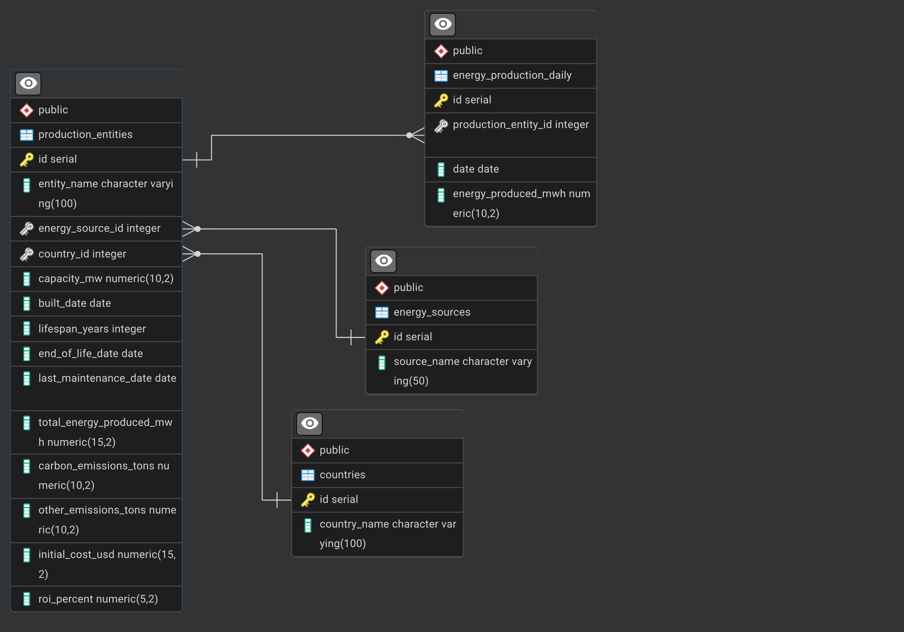

# Practice on the Energy database

The energy database is available : [energydb.sql](https://skatai.com/assets/db/energydb.sql)


Restoring from the database backup will create a new database `energy_workshop`. In PSQL just do


```sql
\i <path to the sql file>/energydb.sql
```


Four tables, many rows, 43Mb of data.




See how the database was created with PL/pgSQL functions: [Crearing the Energy Production Database](/dbsql/creating_energy_database/) for an explanation.

As usual you can restore the sql backup in psql or from the command line.

## Indexing Exercises

The goal of this exercise is to illustrate the impact of B-tree and Hash indexes on a table attribute.

Start by EXPLAIN ANALYZE a simple select query and note the real performance of the query in terms of cost and total execution time.

We'll add indexes (B-tree and Hash) on that column to show that adding indexes can or sometimes cannot improve the query performance.

We'll look at different types of filtering :

- operator : =, range, < or >
- resulting volume of the filtering : when the query returns a unique record or a few, more than a few or many records

and compare the EXPLAIN ANALYZE plans.

We'll also look at INSERTS queries to understand the overhead brought by the presence of indexes.

## Keep in mind

Here are some key points for you to keep in mind:

1. Hash indexes are generally best for equality conditions, while B-tree indexes are versatile and can handle equality, range, and sorting operations.

2. The effectiveness of an index depends on various factors, including the selectivity of the query (i.e., how many rows it's expected to return relative to the total number of rows in the table).

3. Sometimes, the query planner might choose not to use an index if it determines that a sequential scan would be faster (e.g., when returning a large portion of the table).

4. Multi-column indexes can be particularly useful for queries that filter on multiple columns simultaneously.

5. Function-based indexes can improve performance for queries that use functions or expressions in their WHERE clauses.

## The database

The results will depends on the volume of data your version of the `energydb` has generated.

If you don't see major differences in the performance time of the queries with or without indexes, then don't hesitate to generate more data using the `generate_daily_production` and `generate_production_entities` functions.

The results presented in this document are based on 400k production entities.

## Exercise 1: Equality Condition with Hash Index vs. B-tree Index

The candidate query is :

```sql
SELECT * FROM production_entities
WHERE energy_source_id = 1;
```

There are only 6 types of energy sources in the database. So this query will return quite a large amount of rows.

Our **baseline** consists of this query without any index on the `energy_source_id` column.

### No Index

Run the following query and use EXPLAIN ANALYZE to evaluate its performance:

```sql
EXPLAIN ANALYZE SELECT * FROM production_entities
WHERE energy_source_id = 1;
```

**results** : here's a possible query plan (yours may differ)

```sql
 Seq Scan on production_entities  (cost=0.00..20187.25 rows=66643 width=81) (actual time=0.009..57.848 rows=66692 loops=1)
   Filter: (energy_source_id = 1)
   Rows Removed by Filter: 333408
 Planning Time: 0.055 ms
 Execution Time: 61.401 ms
 ```

**Interpretation** : as expected, the planner uses a Sequential Scan to scan all the table rows and apply the filtering condition. The baseline query time is `61.401 ms` with a cost of `20187.25`.

### Add B-tree

Create a B-tree index with

```sql
create index idx_energy_source_id on  production_entities (energy_source_id);
```

check that the index has been created. `\d production_entities` should include this line

```sql
Indexes:
    "idx_energy_source_id" btree (energy_source_id)
```

Now repeat the EXPLAIN ANALYZE query.

**results** : A possible query plan (yours may differ)

```sql
 Bitmap Heap Scan on production_entities  (cost=744.91..16763.94 rows=66643 width=81) (actual time=5.098..23.919 rows=66692 loops=1)
   Recheck Cond: (energy_source_id = 1)
   Heap Blocks: exact=5981
   ->  Bitmap Index Scan on idx_energy_source_id  (cost=0.00..728.25 rows=66643 width=0) (actual time=4.120..4.121 rows=66692 loops=1)
         Index Cond: (energy_source_id = 1)
 Planning Time: 0.373 ms
 Execution Time: 29.159 ms
```

**Interpretation** : as expected, the planner uses a Bitmap Index Scan + Bitmap Heap Scan (since there are quite a lot of rows in the result) leveraging the index. The time has gone down to `29.159 ms` and the cost to `16763.94`.

Adding the index reduces the query execution time by a rough factor of 2

---

# Recap: Bitmap Index Scan + Bitmap Heap Scan

## 1. Bitmap Index Scan:

Its job is to efficiently find the rows in the `production_entities` table that match the condition `energy_source_id = 1`.

How it Works:

-The index (idx_energy_source_id) stores a mapping between energy_source_id values and the corresponding row identifiers (TIDs) in the production_entities table.
- The index scan looks up the TIDs associated with energy_source_id = 1.
- Instead of immediately fetching the rows from the table, the index scan creates a bitmap. A bitmap is a data structure where each bit represents a potential row in the table. The bits corresponding to the TIDs found in the index are set to 1, and the rest are set to 0.

**Cost and Rows**: The cost=0.00..728.15 and rows=66630 estimates suggest that the index scan is relatively inexpensive and is expected to find a significant number of rows.

**Actual Time and LoLoops**: The actual time=5.105..5.105 and rows=66692 loops=1 indicate that the index scan took about 5 milliseconds and found 66,692 rows that match the condition.

## 2. Bitmap Heap Scan:

The Bitmap Heap Scan uses the bitmap created in the previous step to retrieve the actual rows from the table.

How it Works:

- The bitmap from the Bitmap Index Scan is used to efficiently locate the rows that need to be fetched from the production_entities table.
- The Bitmap Heap Scan reads the table data pages directly from disk (or memory if they are cached) and retrieves only the rows whose corresponding bits are set in the bitmap.
- The Recheck Cond: (`energy_source_id = 1`) indicates that PostgreSQL rechecks the condition `energy_source_id = 1` on the rows retrieved from the heap. This is necessary because bitmaps can sometimes have false positives (bits set to 1 even though the row doesn't actually match the condition). This can happen due to concurrency issues or how the bitmap is constructed.

The Heap Blocks: exact=5979 indicates that 5979 heap blocks were accessed.

**Cost and Rows**: The cost and rows estimates suggest that the heap scan is more expensive than the index scan because it involves reading data pages from the table.

**Actual Time and Loops**: The actual time and row indicate that the heap scan took about 63 milliseconds and retrieved 66,692 rows.

## Why Use Bitmap Scans?

Bitmap scans are often used when:

The query involves multiple conditions (predicates): PostgreSQL can combine multiple bitmaps from different index scans using boolean operations (AND, OR) to efficiently identify the rows that satisfy all the conditions. In your case, there's only one condition, but the planner might still choose a bitmap scan if it estimates it to be efficient.

The selectivity of the index is not very high: If the index returns a large percentage of the table's rows, a bitmap scan can be more efficient than a regular index scan because it avoids repeatedly accessing the same data pages.

The table is large: Bitmap scans can be particularly effective for large tables where random access to individual rows can be expensive.

## In this specific case:

Even though you have a single condition (energy_source_id = 1), PostgreSQL's query planner has determined that a bitmap scan is the most efficient way to retrieve the data. This might be because a significant portion of the production_entities table has energy_source_id = 1, making a bitmap scan more efficient than directly using the index to fetch rows one by one. Also, it could be due to the statistics of the table, which may lead the planner to think it is the most efficient.


---
# When the index slows down the query

In some cases, the index can slow down the query. and you will find that the query + index takes longer than the simple sequential scan (no index on `energy_source_id`).

Here's a breakdown of why this might happen:

- Planner Misestimation: The query planner relies on table statistics to estimate the cost of different execution plans. If the statistics are inaccurate or outdated (e.g., haven't been updated after significant data changes), the planner might misjudge the cost of the bitmap scan and overestimate its efficiency compared to the sequential scan. Specifically, it might be underestimating the cost of the Bitmap Heap Scan.

In this case, the planner estimates that 66630 rows match the condition in both cases. However, the sequential scan's plan shows Rows Removed by Filter: 333408. This means the entire table was scanned (66692 + 333408 rows). The bitmap scan avoided scanning those extra rows, but the **overhead of the bitmap operations outweighed the benefit**.

- Overhead of Bitmap Operations: Bitmap scans involve creating and manipulating bitmaps, which have their own overhead. This overhead includes memory allocation, bitwise operations (AND, OR), and the recheck condition.

- Sequential Scan Efficiency: Sequential scans can be surprisingly efficient, especially when the data is stored contiguously on disk and can be read in large chunks. Modern storage systems and caching mechanisms can further improve the performance of sequential scans.

If a significant portion of the table needs to be read anyway (as indicated by the large number of rows removed by the filter), a sequential scan might be faster than the bitmap scan because it avoids the overhead of index access and bitmap operations.

- I/O Characteristics: Bitmap scans can lead to more random I/O patterns, as the Bitmap Heap Scan fetches rows based on the bitmap, which might not correspond to the physical order of the data on disk.

Sequential scans, on the other hand, involve reading the data in a linear fashion, which can be more efficient for disk access.

- Table Size: For smaller tables, the overhead of using an index at all might outweigh the benefits. A sequential scan reads the entire table from start to finish, which can be faster than jumping around the table using an index.


---


# Add Hash Index

Let's do the same but now with a Hash Index.

But first drop the b-tree inedx with

```sql
drop index idx_energy_source_id;
```

Create the hash index with

```sql
create index idx_energy_source_id  on  production_entities USING HASH (energy_source_id);
```

(took 10 seconds)

and repeat the EXPLAIN ANALYZE of the query.

**results** : A possible query plan (yours may differ)

```sql
 Bitmap Heap Scan on production_entities  (cost=2196.48..18215.52 rows=66643 width=81) (actual time=4.966..27.260 rows=66692 loops=1)
   Recheck Cond: (energy_source_id = 1)
   Heap Blocks: exact=5981
   ->  Bitmap Index Scan on idx_energy_source_id  (cost=0.00..2179.82 rows=66643 width=0) (actual time=3.797..3.797 rows=66692 loops=1)
         Index Cond: (energy_source_id = 1)
 Planning Time: 0.281 ms
 Execution Time: 32.655 ms
```

**Interpretation** : the Hash Index brings a similar performance boost to a B-tree index with a cost of `18215` and an execution time of around 30ms.

Note: the Hash index is only applicable on equalities. It would not be used with a query like

```sql
SELECT * FROM production_entities WHERE energy_source_id < 2;
```

In that case the query plan is a sequential scan. although the filtering is the same

```sql
 Seq Scan on production_entities  (cost=0.00..11025.25 rows=66630 width=81) (actual time=0.006..29.636 rows=66692 loops=1)
   Filter: (energy_source_id < 2)
   Rows Removed by Filter: 333408
 Planning Time: 0.055 ms
 Execution Time: 32.731 ms
```

## Exercise 2: Join  query

Let's do the same exercise on a query that produces the same result but that uses the values of the `energy_sources` table.

The query is :

```sql
EXPLAIN ANALYZE SELECT *
FROM production_entities pe
join energy_sources es on es.id = pe.energy_source_id
WHERE es.source_name = 'Solar';
```

- EXPLAIN ANALYZE the query without any index on either `energy_source_id` or `source_name`
- create a B-tree index on energy_sources source_name and compare
- create a Hash index on energy_sources source_name and compare

OR create both indexes

```
CREATE INDEX idx_energy_sources_source_name ON energy_sources (source_name);

CREATE INDEX idx_production_entities_energy_source_id ON production_entities (energy_source_id);
```


## Exercise 3: Range Condition with B-tree Index

Run the following query and use EXPLAIN ANALYZE to analyze its performance:

```sql
EXPLAIN ANALYZE
SELECT * FROM production_entities
WHERE capacity_mw BETWEEN 100 AND 5000;
```

Now create a B-tree index on the `capacity_mw` column:

```sql
CREATE INDEX idx_btree_capacity_mw ON production_entities USING BTREE (capacity_mw);
```

Run the EXPLAIN ANALYZE query again and compare the results. Why is the index not put to use ?

Now reduce the range in the query until the the planner uses the index.

What kind of boost do you get in terms of execution time ?

## Exercise 4: Multi-column Index

Run the following query and use EXPLAIN to analyze its performance:

```sql
EXPLAIN ANALYZE
SELECT * FROM production_entities
WHERE country_id = 1 AND built_date > '2010-01-01';
```

Create a multi-column B-tree index:

```sql
CREATE INDEX idx_btree_country_built_date ON production_entities USING BTREE (country_id, built_date);
```

- Run the EXPLAIN ANALYZE query again and compare the results.

- What if the condition is just based on the country_id (`WHERE country_id = 1 ;`) ?
- What if the condition is just based on the built_date (`WHERE  built_date > '2010-01-01';`) ?

## Exercise 5: Function-based Index

Run the following query and use EXPLAIN to analyze its performance:

```sql
EXPLAIN ANALYZE
SELECT * FROM production_entities
WHERE EXTRACT(YEAR FROM built_date) = 2015;
```

Create a function-based index:

```sql
CREATE INDEX idx_btree_built_year ON production_entities USING BTREE (EXTRACT(YEAR FROM built_date));
```

Run the EXPLAIN ANALYZE query again and compare the results.

## Exercise 6: HASH Index on JOIN Condition

Run the following query and use EXPLAIN ANALYZE to analyze its performance:

```sql
EXPLAIN ANALYZE
SELECT pe.entity_name, epd.date, epd.energy_produced_mwh
FROM energy_production_daily epd
JOIN production_entities pe ON epd.production_entity_id = pe.id
WHERE epd.date BETWEEN '2023-01-01' AND '2023-12-31';
```

Create a HASH index on the `production_entity_id` column in the `energy_production_daily` table:

```sql
CREATE INDEX idx_hash_production_entity_id ON energy_production_daily USING HASH (production_entity_id);
```

Run the EXPLAIN ANALYZE query again and compare the results.

Optionally, create a B-tree index on the `date` column to further improve performance:

```sql
CREATE INDEX idx_btree_date ON energy_production_daily USING BTREE (date);
```

Run the EXPLAIN ANALYZE query a third time and compare the results.

For this exercise, students should:

## Other experiments

You can experiment with other types of queries with different

- complexity : Joins, CTEs etc
- selectivity of the query: how many rows it returns
- conditions on different types of data. for instance dates columns.
- different operators: BETWEEN

and also increasing the volume of generated data  in the tables `production_entities` and `energy_production_daily`;
