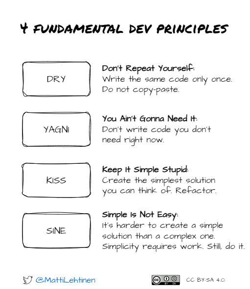

# SQL Anti-Patterns

---

## 1. Mishandling Excessive CASE WHEN Statements

**Bad Query:**
```sql
CREATE VIEW order_dashboard AS
SELECT
  order_id,
  CASE
    WHEN status_code = 1 THEN 'Out of Stock'
    WHEN status_code = 2 THEN 'In Stock'
    WHEN status_code = 3 THEN 'Discontinued'
    -- ... 50 more status codes
  END AS status_name
FROM orders;
```

---

**Why this is wrong:**
Logic is duplicated across multiple views/queries. Other developers copy-paste it or use raw codes. Creates inconsistency and maintenance nightmare.

**Right way:**
```sql
CREATE TABLE status_dimension (
  status_code INT PRIMARY KEY,
  status_name VARCHAR(100)
);

INSERT INTO status_dimension VALUES
  (1, 'Out of Stock'),
  (2, 'In Stock'),
  (3, 'Discontinued');

SELECT o.order_id, s.status_name
FROM orders o
JOIN status_dimension s ON o.status_code = s.status_code;
```

---

## 2. Using Functions on Indexed Columns

**Bad Query:**
```sql
SELECT * FROM customers
WHERE UPPER(name) = 'JOHN SMITH';
```

**Why this is wrong:**
The UPPER() function prevents the database from using an index on the `name` column. Forces a full table scan instead of a fast index lookup.

**Right way:**

>  create an indexed `UPPER(name)` column

or

```sql
SELECT * FROM customers
WHERE name = 'john smith';
```


_Using functions on indexed columns in the WHERE clause can prevent the query engine from effectively using the index. The index stores the **raw data** of the column. When a function is applied, the database needs to compute the function for each row to compare it with the search criteria. The benefit of the index is negated._

---

## 3. Using SELECT * In Views

**Bad Query:**
```sql
CREATE VIEW customer_summary AS
SELECT * FROM customers;
```

---

```sql
CREATE VIEW customer_summary AS
SELECT * FROM customers;
```

If someone adds columns to `customers` later, this view inherits them automatically. Schema changes break downstream views. You also bring in columns you don't need.

**Right way:**
```sql
CREATE VIEW customer_summary AS
SELECT
  customer_id,
  customer_name,
  email,
  registration_date
FROM customers;
```

---

## 4. Overusing DISTINCT to Fix Duplicates

**Bad Query:**
```sql
SELECT DISTINCT o.order_id, c.customer_name, COUNT(*)
FROM orders o
JOIN customers c ON o.customer_id = c.customer_id
GROUP BY o.order_id, c.customer_name;
```

---

**Why this is wrong:**

DISTINCT masks the real problem: a bad join.

The DISTINCT keyword hides incomplete join logic that will cause inconsistent metrics when others use this data.

**Right way:**

use INNER join

```sql
SELECT o.order_id, c.customer_name, COUNT(o.order_id) as order_count
FROM orders o
INNER JOIN customers c ON o.customer_id = c.customer_id
GROUP BY o.order_id, c.customer_name;
```

---

## 5. Excessive View Layer Stacking

**Bad Query:**
```sql
CREATE VIEW v1 AS SELECT * FROM base_table WHERE status = 'active';
CREATE VIEW v2 AS SELECT * FROM v1 WHERE amount > 100;
CREATE VIEW v3 AS SELECT * FROM v2 WHERE region = 'US';

SELECT * FROM v3;
```

---

**Why this is wrong:**
Each query expands all nested views. Performance degrades. Debugging requires tracing through multiple layers.

**Right way:**
```sql
CREATE MATERIALIZED VIEW sales_summary AS
SELECT order_id, customer_id, amount, region
FROM base_table
WHERE status = 'active'
  AND amount > 100
  AND region = 'US';

SELECT * FROM sales_summary;
```

---

## 6. Nested Subqueries That Do Too Much

**Bad Query:**
```sql
SELECT * FROM (
  SELECT * FROM (
    SELECT * FROM (
      SELECT order_id, amount FROM orders WHERE status = 'complete'
    ) WHERE amount > 100
  ) WHERE customer_id IN (SELECT id FROM vip_customers)
) WHERE order_date > '2024-01-01';
```

---

**Why this is wrong:**
Deep nesting (3+ levels) is hard to debug and understand. Logic gets scattered. Hard to test individual steps.

**Right way:**
```sql
WITH completed_orders AS (
  SELECT order_id, customer_id, amount, order_date
  FROM orders
  WHERE status = 'complete'
),
large_orders AS (
  SELECT * FROM completed_orders
  WHERE amount > 100
),
vip_orders AS (
  SELECT lo.*
  FROM large_orders lo
  JOIN vip_customers v ON lo.customer_id = v.id
)
SELECT * FROM vip_orders
WHERE order_date > '2024-01-01';
```

---

## Summary

| Anti-Pattern | Fix |
|--------------|-----|
| Scattered CASE WHEN | Centralize in dimension table |
| Functions on indexed columns | Index the function or normalize input |
| SELECT * in views | Explicitly list columns |
| DISTINCT to fix duplicates | Fix the join logic |
| Stacked views | Materialize and flatten |
| Deep nested subqueries | Use CTEs |


---

## Good practices

whether writing sql queries or code in python, go, rust, node, react, ...




from [DRY, YAGNI, KISS and SINE - 4 Most Important Software Development Principles](https://mattilehtinen.com/articles/4-most-important-software-development-principles-dry-yagni-kiss-and-sine/)

