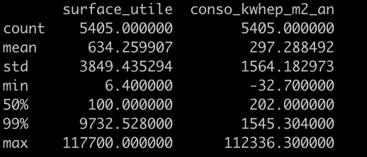
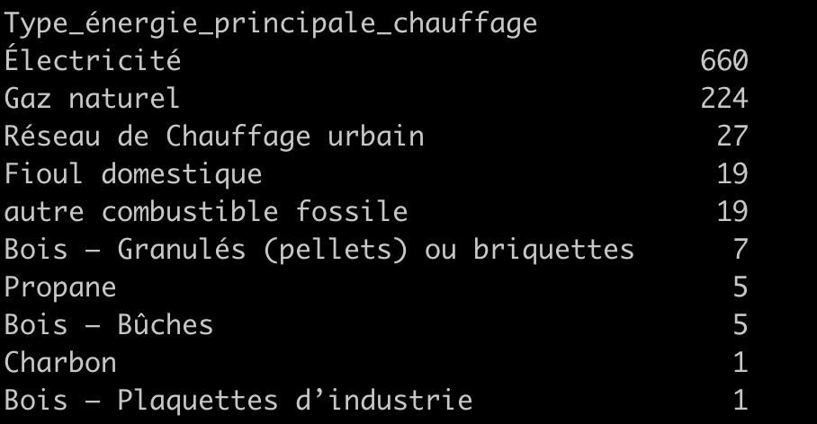
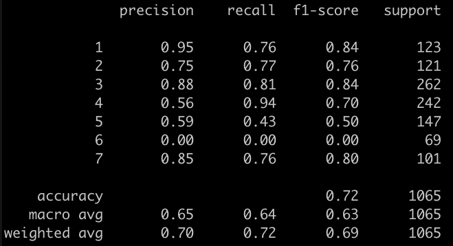

<h2><a id ="a10" class ="anchor-offset ">Quelles sont les limites du notebook Jupyter ?</a></h2>


Le notebook Jupyter est un outil fantastique en ce qu'il donne un accès immédiat à un environnement de développement qui permet de montrer ses explorations avec d'autres personnes. De plus les services comme Google Colab ou Kaggle Notebooks permettent de s'affranchir des limites de son ordinateur perso. C'est un outil fabuleux d'exploration des données, de partage et de démocratisation de la data science.

Cependant, travailler sur un Jupyter notebook apporte son lot de tracasseries. Qui n'a pas été piégé par une erreur incompréhensible due à l'exécution des cellules dans le mauvais ordre ?

Étant donné qu'un notebook Jupyter combine le code, les résultats et la documentation dans un seul même fichier JSON, il n'est pas possible d'utiliser Git. Donc le suivi des modifications, la gestion des conflits de code voir la collaboration avec d'autres personnes est dans les choux.

En bref :
1. Il est impossible de contrôler les versions avec Git.
1. Il n'y a pas de tests unitaires.
1. C'est lent, car tout est en mémoire dans le navigateur. Ça ne _scale_ pas !
2. Ça n'encourage pas à écrire du code propre, plutôt le contraire.
5. Il n'y pas de moyen de gérer l'environnement en précisant les versions des packages

<div class="standout">
Adapté à l'ébauche de prototypes, le notebook Jupyter n'est pas le bon outil pour déployer des modèles en production.
</div>

<h2><a id ="a20" class ="anchor-offset">Structure du notebook</a></h2>

Cependant, comme le notebook est l'outil de prédilection des data scientists, il est le point de départ idéal du projet MLOps-DPE.
Nous allons donc commencer par développer un simple notebook de nettoyage des données et d'entraînement d'un modèle de prédiction des DPE. Dans ce notebook, nous recherchons la simplicité et non la performance.

Le notebook est composé de deux parties : la préparation des données (valeurs manquantes, valeurs aberrantes et numérisation) suivie de l'entraînement du modèle. Nous suivons un processus [scikit-learn](https://scikit-learn.org) très classique

<div class="yourturn">
<strong>A vous</strong> :
vous allez d'abord
<ul>
<li>
charger le dataset (une ligne avec pandas)
</li>
<li>
supprimer la plupart des variables, pour ne garder qu'un nombre réduit de variables prédictives,
</li>
<li>
nettoyer et transformer les données : encodage des catégories, valeurs manquantes et aberrantes, rien que du très classique
</li>
</ul>
</div>


Une fois les données numérisées, elles sont prêtes pour l'entraînement du modèle.

<div class="yourturn">
<strong>A vous</strong> :
Vous allez donc
- partager les données en un jeu d'entraînement et un jeu de test. La fameuse fonction `train_test_split` de scikit-learn
- entraîner un modèle de [forêt aléatoire de scikit-learn](https://scikit-learn.org/stable/modules/generated/sklearn.ensemble.RandomForestClassifier.html) avec de la validation croisée
- optimiser le modèle en sélectionnant les meilleurs paramètres parmi le nombre d'arbres (`n_estimators`), leur profondeur (`max_depth`) et le nombre minimum d'échantillons dans chaque feuille (`min_samples_split`) avec un `grid search CV`
- analyser différentes métriques, matrice de confusion et scores. On regardera l'AUC, la précision et le recall
</div>

<div class="bytheway">
Comme l'objectif du projet MLOps-DPE est de construire un pipeline de production, nous laissons de côté la partie optimisation des modèles ainsi que le feature engineering poussé. Un modèle de la famille XGBoost serait probablement plus performant qu'une simple random forest. mais la random forest est plus simple à paramétrer que le XGBoost.
</div>

Nous sommes dans un problème de classification multiclasse. Les étiquettes DPE vont de A à G, soit 7 classes. La variable cible est `etiquette_DPE`. Nous supprimons la variable `etiquette_GES` qui est trop semblable à la variable cible afin d'éviter la fuite d'information (leakage).


Le notebook en ligne est disponible sur Google Colab à [https://colab.research.google.com/drive/1AHWmNqAPmili_yfOuYTGrXtXCIz5i4pC](https://colab.research.google.com/drive/1AHWmNqAPmili_yfOuYTGrXtXCIz5i4pC)


<div class="yourturn">
La suite du chapitre explique le code de ce notebook Colab. Mais ce n'est jamais qu'une proposition.
Vous n'êtes absolument pas obligé de suivre cette version. Vous pouvez tout à fait implémenter votre propre version du notebook.
</div>


<h2><a id ="a30" class ="anchor-offset">Transformer les données</a></h2>


#### 1. charger le dataset

```
# importer les librairies
import pandas as pd
import numpy as np
import re
import datetime
from collections import Counter
```

Charger le dataset directement à partir de l'url sur le site de l'ADEME.

```
url = "https://data.ademe.fr/data-fair/api/v1/datasets/dpe-v2-tertiaire-2/lines?size=10000&format=csv&after=10000%2C965634&header=true"
data = pd.read_csv(url)
```
Le dataset de base fait 10.000 échantillons, mais comme nous verrons de nombreux échantillons n'ont pas d'étiquette DPE et ne peuvent donc pas être utilisés pour entraîner un modèle.

#### 2. Renommer les variables

Les noms des variables sont particulièrement alambiqués avec des degrés (°, m², ...), des parenthèses, etc. Il vaut mieux standardiser tout cela et renommer les colonnes en minuscule avec un alphabet simplifié. Par exemple :

- `N°DPE` -> `n_dpe`
- `Conso_kWhep/m²/an` -> `conso_kwhep_m2_an`
- `N°_département_(BAN)` -> `n_departement_ban`

La fonction `rename_columns()` utilise une série de regex de remplacement

```
def rename_columns(columns):
    # en minuscule
    columns = [col.lower() for col in columns]
    # regex de remplacement
    rgxs = [
        (r"[°|/|']", "_"),
        (r"²", "2"),
        (r"[(|)]", ""),
        (r"é|è", "e"),
        (r"_+", "_"),
    ]
    # on remplace toutes les colonnes une par une
    for rgx in rgxs:
        columns = [re.sub(rgx[0], rgx[1], col) for col in columns]

    return columns

data.columns = rename_columns(data.columns)
```

Ce qui donne maintenant des noms de colonnes bien plus sympathiques.


<div class="bytheway">
Les <strong>regex</strong> c'est un véritable superpouvoir pour analyser des données, extraire de l'info et transformer du texte. Je vous conseille fortement d'investir un peu de temps pour en comprendre les bases. Nos amis Claude, GPT, Gemini ou CoPilot, se feront un plaisir de vous écrire les bonnes expressions à partir de quelques exemples. Fun fact : En français regex se dit <em>expressions rationnelles</em>. Voici une bonne <a href="https://developer.mozilla.org/fr/docs/Web/JavaScript/Guide/Regular_Expressions/Cheatsheet" target="_blank">antisèche</a>.
</div>

#### 3. Limiter le nombre de variables

De façon arbitraire, supprimons la plupart des variables.
Il est probable que nous jetons ainsi de l'information qui serait surement utile au modèle. Mais notre but est de mettre le modèle en production sans passer trop de temps sur le feature engineering. Libre à vous de trouver quelles variables il vaudrait mieux conserver.

Voici donc les 9 variables numériques et catégoriques que nous gardons pour entraîner le modèle..

```
columns_int = [
    "version_dpe",
    "surface_utile",
    "conso_kwhep_m2_an",
    "conso_e_finale_energie_n_1",
]

columns_categorical = [
    "periode_construction",
    "secteur_activite",
    "type_energie_principale_chauffage",
    "type_energie_n_1",
    "type_usage_energie_n_1",
]
```

Nous gardons la cible et le numéro de chaque DPE (pour débugger plus tard si nécessaire).
```
target = 'etiquette_dpe'
id_col = 'n_dpe'
```


```
train_columns = columns_int + columns_categorical + [target, id_col]
```

#### 4. Encodage et valeurs manquantes

Traitons tout d'abord les valeurs manquantes de la variable cible.

```
data.dropna(subset="etiquette_dpe", inplace=True)
```

La plupart des échantillons du dataset ne permettent pas d'entraîner un modèle, on les supprime. Sur les 10k échantillons, il n'en reste que 5405 (~54%).

**Les floats**

Les colonnes `floats` sont converties en INT car il n'y a pas lieu de garder une précision au-delà de la virgule.

<div class='bytheway'>
Convertir les floats en int permet en général à l'algo d'avoir une empreinte de mémoire plus faible.
</div>

La variable `version_dpe`, dont les valeurs sont `[2.2, 2.1, 2. , 2.3, 1.0 , 1.1]`, est une variable de catégorie. Mais nous pouvons la considérer comme une variable numérique. Il faut alors la multiplier par 10 pour pouvoir la convertir en `integer` sans perte d'information.

```
data['version_dpe'] = data['version_dpe'] *10
```

Toutes les variables numériques étant positives, on va remplacer les valeurs manquantes par un -1 puis les caster en INT.

```
for col in columns_int:
    data[col].fillna(-1.0, inplace=True)
    data[col] = data[col].astype(int)
```


#### 5. Valeurs aberrantes

Bien que nous ayons supprimé beaucoup de variables, il reste quelques échantillons dont les valeurs sont probablement des anomalies comme le montre leur 99ième percentile :

```
data[columns_int].describe(percentiles = [0.99])
```



Certains échantillons ont une valeur maximum 10 fois supérieure au 99 percentile. On va les supprimer par précaution.

```
data = data[data['surface_utile'] < 9800]
data = data[data['conso_kwhep_m2_an'] < 2000]
```


Note : ici nous remplaçons la dataframe `data` avec sa version filtrée. Le nom de la dataframe ne change pas.
Si nous avions changé le nom de la dataframe en écrivant par exemple ```filtered_data =  data[data['surface_utile'] < 9800]```
alors `filtered_data` serait non pas une copie de `data`, mais une <strong>vue</strong> de `data`. Toute modification sur `filtered_data` entrainerai la même modification sur `data` et un message de warning de type <em>trying to make a </em>.
Pour éviter cela, on force la création d'une copie de la `data` d'origine en ajoutant `copy()` : ``` filtered_data =  data[data['surface_utile'] < 9800].copy()```


#### 6. Variables catégoriques

Traitons tout d'abord les valeurs manquantes en remplaçant les vides par la string  "*inconnue*".

```
for col in columns_categorical:
    data[col].fillna("inconnue", inplace=True)
```


Il existe de nombreuses méthodes pour encoder des valeurs catégoriques : one-hot-encoding, encodage ordinal, encodage binaire, etc.

<div class="bytheway">
La librairie <a href='https://pypi.org/project/category-encoders/' target='_blank'>category encoders</a> offre un large choix de méthodes d'encodage.
</div>

Dans notre contexte, nous allons simplement assigner arbitrairement une valeur entière à chaque catégorie.
Ouh là ?! Cela ne risque-t-il pas de rajouter de l'information dans les données en ordonnant les valeurs alors qu'elles ne le sont pas initialement (non ordinale) me dites-vous ?

En effet ! Cependant, dans mon expérience, cela ne changera pas grand-chose en termes de performances du modèle par rapport à d'autres méthodes comme le `one hot encoding` ou l'encodage binaire. Surtout lorsque l'on utilise des modèles à base d'arbres de décision comme les forêts aléatoires qui se forment à partir de seuils de valeurs dans les nœuds. Par contre, on évitera la prolifération des dimensions et on gagnera en simplicité et clarté d'encodage.

Toutefois, pour que cet ordre induit ait un sens, nous pouvons ordonner les catégories en fonction de leur fréquence. Cela nous permettra aussi de regrouper ensemble les valeurs moins fréquentes en associant une même valeur entière pour plusieurs catégories`a faible cardinalité.

Par exemple, pour les modes de chauffage (`data['type_energie_principale_chauffage'].value_counts()`), on trouve



On pourra donc associer les valeurs Propane, Bois - Bûches, Charbon et Bois Plaquette à la même valeur entière, car ces catégories ont une très faible cardinalité.

De même pour ```data['type_usage_energie_n_1'].value_counts(dropna = False)```,

```
type_usage_energie_n_1
NaN                                   4548
périmètre de l'usage inconnu          4169
Chauffage                              848
Eau Chaude sanitaire                   219
```

On peut alors définir le dictionnaire suivant pour le type d'énergie qui concerne les variables : type_energie_principale_chauffage, type_energie_n_1, (mais aussi type_energie_n_2, type_energie_n_3 qu'on a supprimé)

```
map_type_energie = {
    "non renseigné": -1,
    "Électricité": 1,
    "Électricité d'origine renouvelable utilisée dans le bâtiment": 1,
    "Gaz naturel": 2,
    "Butane": 2,
    "Propane": 2,
    "GPL": 2,
    "Fioul domestique": 3,
    "Réseau de Chauffage urbain": 4,
    "Charbon": 5,
    "autre combustible fossile": 5,
    "Bois - Bûches": 6,
    "Bois - Plaquettes forestières": 6,
    "Bois - Granulés (pellets) ou briquettes": 6,
    "Bois - Plaquettes d'industrie": 6,
}
```
De même pour la variable `type_usage_energie_n_1`.

```
map_type_usage = {
    "non renseigné": -1,
    "périmètre de l'usage inconnu": -1,
    "Chauffage": 1,
    "Eau Chaude sanitaire": 2,
    "Eclairage": 3,
    "Refroidissement": 4,
    "auxiliaires et ventilation": 4,
    "Ascenseur(s)": 5,
    "Autres usages": 6,
    "Bureautique": 6,
    "Abonnements": 6,
    "Production d'électricité à demeure": 6,
}
```

Les autres dictionnaires associés aux variables catégoriques sont explicités dans le notebook [Colab](https://colab.research.google.com/drive/1AHWmNqAPmili_yfOuYTGrXtXCIz5i4pC).

Pour la variable cible, le mapping est direct :

```
map_target = {"A": 1, "B": 2, "C": 3, "D": 4, "E": 5, "F": 6, "G": 7}
```

Pour convertir ensuite les variables il suffit d'appliquer les dictionnaires aux bonnes colonnes en appliquant la fonction :

```
def encode_categorical_with_map(data, column, mapping, default_unknown="inconnue"):
    # valeurs possibles
    valid_values = list(mapping.keys())
    # les valeurs inconnues
    data.loc[~data[column].isin(valid_values), column] = default_unknown
    # valeurs manquantes et inconnues
    mapping[default_unknown] = -1
    # encodage des valeurs connues
    data[column] = data[column].apply(lambda d: mapping[d])
    return data[column]
```

De cette façon :

```
mappings = [
    map_periode_construction,
    map_secteur_activite,
    map_type_energie,
    map_type_energie ,
    map_type_usage]

for col, mapping in zip(columns_categorical, mappings):
    data[col] = encode_categorical_with_map(data, col, mapping)
```

et pour la variable cible `etiquette_dpe`:

```
data[target] = encode_categorical_with_map(data, target, map_target)
```

La dataframe est maintenant entièrement numérisée aussi bien pour les colonnes d'entraînement que pour la variable cible. Il n'y a que l'ID: "*n_nde*" que l'on conserve comme string en tant qu'identifiant des échantillons.

```
all_columns = [id_col] + train_columns + [target]
data = data[all_columns ]

data.reset_index(inplace = True, drop = True)
```
Nous avons donc en sortie du processus de nettoyage et de numérisation, les données d'entraînement suivantes :

- 9 variable prédictrice et une variable cible

- 5322 échantillons


<h2><a id ="a40" class ="anchor-offset ">Entraîner le modèle</a></h2>

Nous allons

1. importer le `RandomForestClassfier` de scikit-learn
2. spécifier les valeurs possible des paramètres : `n_estimators`, `max_depth`, `min_samples_split`
3. utiliser `gridsearchCV` pour entraîner le modèle avec N plis
4. calculer les métriques appropriées

```
from sklearn.model_selection import train_test_split, GridSearchCV, KFold
from sklearn.ensemble import RandomForestClassifier
from sklearn.metrics import classification_report, accuracy_score, roc_auc_score
```

On partage le dataset en une partie d'entraînement et une de test en veillant bien à spécifier le `random_state` pour s'affranchir des effets aléatoires entre plusieurs versions du dataset

```
X = data[train_columns].copy()
y = data[target].copy()
X_train, X_test, y_train, y_test = train_test_split( X, y, test_size=0.2, random_state=808)
```

Initialiser le modèle

```
rf = RandomForestClassifier()
```

Définir l'espace des paramètres :

```
param_grid = {
    "n_estimators": [50, 100],  # Nombre d'arbres
    "max_depth": [2,4],  # Profondeur maximale des arbres
    "min_samples_leaf": [1, 3],  # numbre d'echantillons minimum par feuille
}
```
que l'on va utiliser dans un grid search avec validation croisée :

```
cv = KFold(n_splits=3, random_state=84, shuffle=True)
grid_search = GridSearchCV(estimator=rf, param_grid=param_grid, cv=cv, scoring="accuracy")
```

On entraine le modèle et on observe les résultats

```
grid_search.fit(X_train, y_train)
```

On obtient comme paramètres pour le meilleur modèle :

```
Best parameters: {'max_depth': 4, 'min_samples_leaf': 3, 'n_estimators': 100}
Best cross-validation score: 0.743716232088325
Best model: RandomForestClassifier(max_depth=4, min_samples_leaf=3)
```

Sur le set de test, on obtient les scores suivants :

```
yhat = grid_search.predict(X_test)
print(classification_report(y_test, yhat))
```



<h2><a id ="a50" class ="anchor-offset">Résultats</a></h2>

Le score obtenu est assez mauvais, il faut bien l'avouer. La classe 6 (F) n'est simplement jamais choisie. Cependant, nous avons opéré une série de simplifications assez drastique du dataset et nous avons limité la sélection du modèle à quelques paramètres plutôt contraignants. Ce n'est donc pas si étonnant.


Ce chapitre était un passage obligé pour définir le point de départ du projet.

La façon un peu singulière d'encoder les variables catégoriques nous sera utile dans le prochain chapitre ou vous allez transitionner du notebook a une structure de code sur github. Nous verrons entre autres choses la possibilité d'utiliser pydantic et les dataclass pour simplifier la validation des variables d'entrée. Un point primordial quand notre modèle nagera dans les eaux troubles des données du monde réel.

<div class="">
  <nav aria-label="...">
    <div class="d-flex justify-content-between">
      <a class="btn btn-success prev-link" href="/mlops-dpe/chapitre_01/">
        1. Présentation du dataset DPE tertiaire
      </a>
      <a class="btn btn-success next-link" href="/mlops-dpe/chapitre_03/">
        3. Du notebook au script
      </a>
    </div>
  </nav>
</div>

